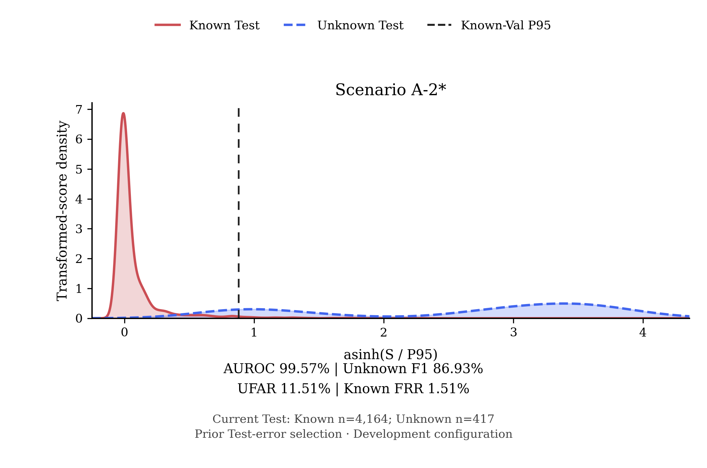

# A-2 当前配置结果

更新日期：2026-11-05（补充分布图；指标沿用2026-11-04重训结果）。项目后续提及“A-2 当前配置结果”时，默认引用本页；原始全量 A-2 结果单独保留，不覆盖。

## 配置与数据范围

- 数据集：USTC-TFC2016；17个已知类，未知类为 Geodo、Htbot、Tinba。
- 单种子：2022；两种方法使用相同 Known Train 34,665条、Known Validation 4,333条。
- 当前测试集：Known 4,164条，Unknown 417条，共4,581条。
- 我们的方法：TrafficFormer／FIG／YaTC 三视图等权特征融合，使用 C2 unit-L2 DES-v1 检测配置；对照为重新训练的 Open-Detect Native（released-code实现）。
- 阈值：两种方法均使用相同2,171条 Known Validation calibration样本的P95（higher）；我们的方法另使用2,162条 Known Validation reference样本进行稳健缩放。Test与Unknown未参与拟合或阈值校准。

## 当前结果（%）

| 指标 | 我们的三视图 + C2 | Open-Detect Native |
|---|---:|---:|
| 已知类 Accuracy | 99.28 | 98.54 |
| 已知类 Macro-F1 | 99.35 | 98.61 |
| 已知类 Weighted-F1 | 99.28 | 98.52 |
| Unknown AUROC | 99.57 | 94.95 |
| Unknown AUPRC | 95.92 | 65.69 |
| Unknown Precision | 85.42 | 54.86 |
| Unknown Recall | 88.49 | 41.97 |
| Unknown F1 | 86.93 | 47.55 |
| 已知／未知二分类 Accuracy | 97.58 | 91.57 |
| UFAR：未知被接受率 ↓ | 11.51 | 58.03 |
| Known FRR：已知被拒绝率 ↓ | 1.51 | 3.46 |

未知为正类。我们的方法TP/FP/FN/TN为369/63/48/4,101；Open-Detect为175/144/242/4,020。闭集Known指标是拒识前分类结果，与二分类Accuracy、开集多分类Accuracy不同。

## 当前配置分数分布（2026-11-05）

本图使用本页登记的4,164条Known和417条Unknown，UFAR为11.51%。[三场景图及PNG／PDF／SVG下载](paper/picture/ch4/20261105_a123_current_config_separability/README.md)中，A-1和A-3沿用原平衡子集，A-2使用当前开发配置，图注标明各自范围。

## 样本来源与原始全量对照

当前测试成员来自此前C2测试错误的事后筛选：相对原始测试集排除310条（Known169条、Geodo141条），不是已证实的数据质量缺陷清理。成员在本次重训前固定，重训后没有再次筛选。它可能偏向我们此前的方法，因此本页是**开发配置结果，不是无偏的原始全量A-2结果**。两种方法使用相同成员并不能消除这项选择偏差。

原始全量测试仍为Known4,333条、Unknown558条；同次重训模型、同一阈值的对照如下（%）：

| 指标 | 我们的方法 | Open-Detect Native |
|---|---:|---:|
| AUROC | 95.21 | 93.34 |
| Unknown F1 | 63.68 | 39.01 |
| UFAR ↓ | 33.87 | 66.13 |
| Known FRR ↓ | 5.35 | 5.12 |

两种方法的架构、外部预训练和训练预算不同，本表比较完整方法，不是同encoder检测头消融，也不等同于论文原始五次实验。

## 可复核来源

- [原始数值CSV](a2_retrained_matched_opendetect_20261104/run_results.csv)：本页主表对应evaluation_view=current_config；全量对照对应full_test_control。
- [冻结配置与筛选来源](a2_retrained_matched_opendetect_20261104/protocol.json)
- [完整对比报告](a2_retrained_matched_opendetect_20261104/comparison_report.md)
- [当前／全量分布图](a2_retrained_matched_opendetect_20261104/known_unknown_comparison.png)
- [独立完整性核验](a2_retrained_matched_opendetect_20261104/completion_verification.json)

本次只登记当前结果入口，不修改历史实验、冻结划分、逐样本分数、checkpoint或论文旧表，不重新训练，也不自动推送。
