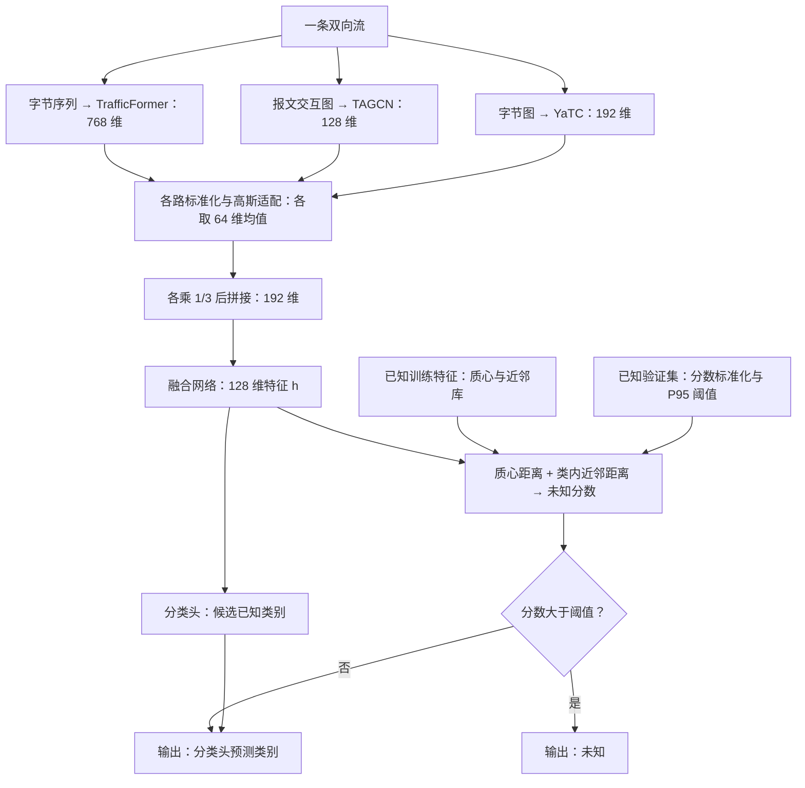

# 方法说明：三视图表示与全局、局部经验支撑的加密流量开集分类

你的方法处理的是：**模型只学习了部分流量类别，实际输入却可能来自未见类别；系统既要正确分类已知流量，也要把缺乏已知样本支持的输入拒识为“未知”。** 为此，你先从字节序列、报文交互图和字节图三个角度学习流量表示，再在融合表示上，用类别质心和真实训练样本的近邻距离判断是否接受分类结果。

本文对应当前方法章及 Stage44 实现。完整公式和训练参数见[方法章](1.md)；这里着重解释问题、流程和各部分的作用。

## 1. 要解决什么问题

闭集分类只在预先给定的类别中选择答案。你的任务增加了一个必要的判断：输入是否有足够依据被归入这些类别。最终输出有两种形式：一个已知类别，或统一的“未知”标记。

以项目的 VNAT 服务级实验为例，四类服务是通信、文件传输、远程访问和流媒体。在留出流媒体的一折中，模型只使用前三类服务的训练、验证样本；测试时，既要区分前三类，也要识别此前没有进入本折训练和校准的流媒体样本。这里的类别定义是服务，不能把这个结果直接解释成每一种应用都能被独立识别。[协议](../../../stage44_vnat_coarse_service_loso_open_set/vnat_loso_protocol.json)

这项任务有三个直接难点：

- **如何表示流量。** 同一条流包含字节内容、方向、长度、时序和报文间关系，方法需要把这些不同形式的信息转换成可学习的特征。
- **如何判断是否属于已知范围。** 分类头给出“最像哪一类”，还需要独立判断该输入是否接近实际见过的已知样本。
- **如何设定未知判定阈值。** 当前冻结任务不使用未知样本训练或校准，因此阈值必须从已知验证样本中确定。

“未知”取决于本次训练包含哪些类别。它可以是未见的正常应用，也可以是未见的攻击类型。当前方法输出统一未知标记，不进一步命名新类别，也没有在这一流程中完成未知类别聚类或增量学习。

## 2. 整体流程

一条双向流同时进入三个分支，得到三个向量；适配和融合后形成一个 128 维向量。随后，同一向量用于类别预测和未知拒识。

图中的均值表示对应推理过程。训练适配器时会采样；正式推理时使用确定性的均值，关闭 dropout。[融合实现](../../../stage31_four_dataset_three_view_equal/train_equal_fusion.py#L43)、[推理实现](../../../stage44_vnat_coarse_service_loso_open_set/scripts/evaluate_fold.py#L84)

## 3. 三个视图分别做什么

三个分支处理的是同一条流，按流 ID 和标签对齐。空流不进入编码；非空短流保留，缺失位置按各分支规则处理。

| 分支 | 如何构造输入 | 输出 | 设计上希望提供的信息 |
| --- | --- | --- | --- |
| TrafficFormer 字节序列分支 | 前 5 个报文，每个读取以太网头后的至多 64 字节，生成相邻字节二元组，再分词并限制为 320 个词元 | 768 维 | 字节序列及其上下文模式 |
| FIG + TAGCN 图分支 | 前至多 30 个报文作为节点，按方向连续段及相邻段关系连边 | 128 维 | 报文方向、长度、时序与交互结构 |
| YaTC 字节图分支 | 前 5 个报文各保留固定的 80 字节头部区域和 240 字节载荷区域，补齐后排列为 40×40 单通道图 | 192 维 | 固定布局下的报文头部与载荷字节模式 |

图分支中的 burst 指连续、同方向发送的报文段。每个节点有 7 项属性：方向、捕获长度、相对首包时间、所在段的报文数和总字节数，以及相对上一段的报文数比和字节数比。TAGCN 聚合图邻域信息，再对真实节点取均值得到流级向量。

多视图设计的动机是组合不同信息来源。是否确实形成互补、哪一路贡献最大，需要消融实验回答；固定使用三个分支本身不能证明每一路都不可替代。这里处理的是可观测字节和流量行为，没有明文解密步骤。

输入和图模型依据：[序列输入](../../../src/preprocessing/trafficformer_input.py)、[FIG 构图](../../../src/preprocessing/fig_graph.py)、[TAGCN](../../../src/stage1/tagcn.py)、[YaTC 输入及 IPv6 兼容处理](../../../stage31_four_dataset_three_view_equal/build_vnat_mfr.py)。

## 4. 如何把三个表示变成一个可判别的表示

### 4.1 标准化与高斯适配

三路原始向量的维数和数值尺度不同。先用已知训练集的均值、标准差，分别对各路特征做逐维标准化，再为每一路训练独立的高斯适配器。

每个适配器经过两层 128 维 ReLU 网络，输出 64 维均值和 64 维对数方差，定义一个对角高斯分布。训练时从这个分布采样，用采样向量预测已知类别；同时加入到标准正态分布的 KL 正则。对单样本、单视图，损失可写成：

$$
\mathcal{L}_{v}(x,y)
=\mathcal{L}_{\mathrm{CE}}(g_v(u_v),y)
+\frac{0.05}{64}\operatorname{KL}\!\left(q_v(u\mid x)\,\|\,\mathcal{N}(0,I)\right).
$$

总损失对样本和三个视图取平均。交叉熵让适配表示保留已知类别的判别信息，KL 项对其分布施加约束。推理时只取均值，因此每一路都得到一个固定的 64 维向量。

适配器完成的是维数统一和带正则的特征变换。它没有显式的跨视图配对对齐损失，也没有把该 KL 值用作最终未知分数。

### 4.2 等权拼接与融合

将三个 64 维均值分别乘以固定权重 $1/3$，然后**拼接**成 192 维向量：

$$
r(x)=\operatorname{concat}\left(\frac{\mu_t(x)}{3},\frac{\mu_g(x)}{3},\frac{\mu_y(x)}{3}\right),
\qquad h(x)=F_\varphi(r(x))\in\mathbb{R}^{128}.
$$

这里保留了三个分支各自的特征位置。融合网络为两层 128 维全连接变换，包含 ReLU 和训练时的 dropout；分类头从 $h(x)$ 预测已知类别。

“等权”指进入融合网络前的缩放系数固定。后续融合层仍然学习参数，因此不能把它理解为三个视图对最终决策的实际贡献恰好相等。当前实现的前向计算也没有用适配器熵动态调整权重。[适配器和等权融合代码](../../../stage31_four_dataset_three_view_equal/train_equal_fusion.py#L43)

## 5. 如何判断一条流是未知

表示训练结束后，冻结所有网络，并提取已知训练集的 128 维融合特征。对每个已知类别，保存两类参照：该类的特征均值，以及该类真实训练样本的特征库。

### 5.1 全局距离：离哪个已知类别的中心最近

设第 $c$ 类的训练特征集合为 $\mathcal{T}_c$，其均值为 $b_c$。输入的全局分数是到最近类别质心的平方欧氏距离：

$$
b_c=\frac{1}{|\mathcal{T}_c|}\sum_{h_i\in\mathcal{T}_c}h_i,
\qquad d_G(x)=\min_c\|h(x)-b_c\|_2^2.
$$

它衡量输入偏离已知类别总体位置的程度。但一个均值无法描述类别内部所有样本的分布形状：例如，某类样本分成几个团，团之间的位置可能接近均值，却没有多少真实样本。这是引入局部距离的动机，并非声称每个数据集都存在这种结构。

### 5.2 局部距离：附近有没有真实的同类训练样本

先选出最近质心对应的类别 $c^*(x)$，再仅在该类的训练特征库中搜索最近的 10 个邻居，计算欧氏距离均值：

$$
c^*(x)=\arg\min_c\|h(x)-b_c\|_2^2,
\qquad d_L(x)=\frac{1}{10}\sum_{h_j\in\mathcal{N}_{10}(x)}\|h(x)-h_j\|_2.
$$

全局距离描述类别总体位置，局部距离补充真实样本邻域的信息。一个输入即使离某个质心不远，也可能因附近缺少训练样本而获得较高的局部分数。

当前版本中，近邻库由**最近质心类别**选择；最终接受后输出的类别由**分类头**选择，两者可能不同。全局项使用平方距离，局部项使用未平方距离的均值。[距离和邻域选择实现](../../../stage44_vnat_coarse_service_loso_open_set/scripts/evaluate_fold.py#L104)

### 5.3 对齐分数尺度，再组合

两种距离不能直接按原始大小比较。方法在已知验证集上，分别计算它们的中位数 $m_a$ 和中位绝对偏差 $\mathrm{MAD}_a$，再组合成当前 DES-v1 分数：

$$
\tilde d_a(x)=\frac{d_a(x)-m_a}{\mathrm{MAD}_a+10^{-8}},\quad a\in\{G,L\},
\qquad s(x)=0.5\tilde d_G(x)+0.5\tilde d_L(x).
$$

分数越高，表示输入越偏离已知训练样本提供的经验支撑。这里的“支撑”可以理解为已知样本实际分布的位置和邻域；分数没有概率含义，也不保证所有未知类别都落在已知样本之外。

### 5.4 用已知验证集设定阈值

在已知验证集上计算最终分数，以第 95 百分位数作为阈值 $\tau$，采用 `higher` 分位数规则。测试时：

$$
f(x)=
\begin{cases}
\arg\max_c\ell_c(x), & s(x)\le\tau,\\
\text{未知}, & s(x)>\tau.
\end{cases}
$$

只有严格超过阈值才拒识，恰好等于阈值时接受。P95 对应已知验证样本上的名义 5% 上尾；有限样本和分数并列会影响实际拒识比例。这个设置不保证未来已知测试流量的误拒率恰好为 5%。[支撑库、校准及阈值实现](../../../stage44_vnat_coarse_service_loso_open_set/scripts/evaluate_fold.py#L274)

## 6. 实际怎样训练和部署

当前方法按阶段训练，随后构建支撑库并校准拒识分数。

| 阶段 | 执行的操作 | 可使用的数据 |
| --- | --- | --- |
| 编码器训练 | 分别微调 TrafficFormer、YaTC，训练 TAGCN；选择各自检查点 | 已知训练集用于梯度更新，已知验证集用于选点 |
| 适配器训练 | 冻结编码器；拟合特征标准化统计量，训练三路 64 维高斯适配器 | 标准化和梯度更新使用已知训练集；验证集选点 |
| 融合头训练 | 冻结编码器和适配器；用交叉熵训练融合网络及分类头 | 已知训练集与已知验证集 |
| 支撑库构建 | 冻结全部网络；按真实类别计算质心、保存类内特征 | 已知训练集 |
| 分数校准 | 计算两种距离的中位数、MAD 和组合分数的 P95 | 已知验证集 |
| 推理 | 计算融合特征、候选类别和未知分数，应用冻结阈值 | 输入流量；不重新拟合模型、支撑库或阈值 |

部署产物除模型权重外，还包括特征标准化统计量、类别质心、类内近邻库、分数校准参数和阈值。近邻库需要保存训练特征，其存储与查询成本随训练样本量增加；单条流还要经过三个编码器，因此现有流程本身不构成实时性能证明。

这里的“未知不参与训练和校准”限定于当前冻结任务。TrafficFormer、YaTC 使用外部预训练权重，现有记录不能证明其预训练语料与所有测试未知类别完全没有重叠。已知验证集也兼顾检查点选择和分数校准，不能据此宣称具有独立校准的误差保证。[完整训练协议](1.md)

## 7. 方法的工作重点与实验支持

从当前实现看，方法的工作重点可以归纳为三个相互连接的设计：组合三种流量表示；通过分阶段训练得到固定融合空间；在该空间上用全局、局部经验距离执行独立的未知拒识。TrafficFormer、TAGCN、YaTC 及图构造均作为已有表征组件使用。项目可以描述这些组件的组合和支撑判定流程，但“首次提出”之类的文献新颖性结论需要另外做相关工作核查。

当前最有力的正面结果来自 Stage44：VNAT 的 23,449 条唯一流，四个完整服务轮流作为未知类，seed 2022；每折已知训练、验证、测试按 group/capture 隔离。下表使用自然测试比例、已知验证 P95，数值为四折等权均值。Unknown 是二分类正类；UFAR 是未知流量被接受为已知的比例，Known FRR 是已知流量被误拒为未知的比例。

| 相同融合表示上的拒识分数 | AUROC ↑ | Unknown F1 ↑ | UFAR ↓ | Known FRR ↓ |
| --- | ---: | ---: | ---: | ---: |
| MSP | 0.918279 | 0.905532 | 0.146316 | 0.049338 |
| Energy | 0.917262 | 0.899566 | 0.153975 | 0.048722 |
| 仅质心距离 | 0.974256 | 0.960963 | 0.055862 | 0.048667 |
| 全局与局部 DES-v1 | **0.992224** | **0.983976** | **0.010907** | **0.044550** |

这些均值已从[逐折结果 CSV](../../../stage44_vnat_coarse_service_loso_open_set/stage44_run_results.csv)重新计算。它们支持：**在这一固定表示和服务划分下，加入局部支撑的组合分数比仅用质心距离有更好的平均表现。** 这不表示所有折的每个指标都改善；例如文件传输折的 UFAR 从质心的 0.003578 变为 DES-v1 的 0.005622。[逐折说明](../../../stage44_vnat_coarse_service_loso_open_set/RESULTS.md)

Stage44B 在相同测试流上比较完整系统，Open-Detect 的平均 AUROC 为 0.741712，三视图加 DES-v1 为 0.992224。这个比较同时包含输入表示、预训练与训练配方等差异；它不能单独证明优势全部来自局部距离。[系统比较](../../../stage44b_vnat_matched_opendetect/matched_comparison.csv)

适用范围仍有明确限制。Stage44 是此前已用于开发的 VNAT 上的单种子诊断。USTC 的三个配对场景中，仅 A-2 的 AUROC、AUPRC 同时优于 Open-Detect；A-1、A-3 的 AUROC 更低。Stage38 的 VPN/Tor 迁移结果也并非一致改善。因此，目前可以说该方法在特定协议中有效，还不能说它已经普遍解决不同数据域中的未知流量识别。[USTC 结果](../../../stage41_a123_matched_open_set_comparison/RESULTS.md)、[迁移结果](../../../stage38_three_view_des_open_set_transfer/RESULTS.md)

本次核对依据是本地方法文本、代码与已保存实验表格，没有重新运行模型。进一步验证应优先检验：同一表示下局部分数的收益是否跨种子、跨数据划分保持，以及相同训练资源下三视图各自带来的增益。
