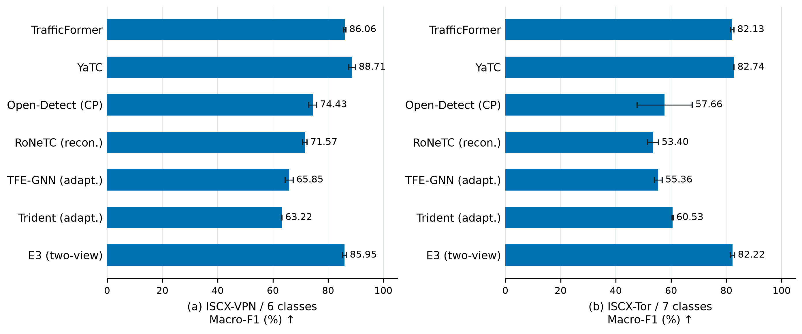

# 4 实验结果与分析

本章从已知类别识别和未知类识别两个方面评估所提出的方法。前者考察三视图融合表示对已知流量类别的判别能力，后者考察全局与局部经验支撑分数在保持已知样本接收能力的同时，能否有效拒识训练阶段未出现的类别。实验以完成训练、冻结模型并完成测试核验的配置为依据，分别报告分类性能、同协议方法对比及拒识分数对比。

当前三视图主实验采用随机种子 2022；历史多方法闭集对照另报告种子 2022、2023 的结果，具体统计口径在表题中注明。百分比指标保留两位小数，性能差值以百分点表示。VNAT 四折均值是不同服务留出任务的等权平均，不代表四次随机种子重复实验。部分数据集及任务曾用于方法开发，因此本章结果属于现有冻结协议下的实验验证，不将其表述为未经开发接触的外部测试结果。

## 4.1 已知类别识别

### 4.1.1 实验设置与评价指标

已知类别识别仅在已知测试集上进行，关闭未知拒识规则，直接使用分类头输出类别。采用准确率（Accuracy）、宏平均 F1（Macro-F1）和加权 F1（Weighted-F1）评价分类性能。其中，Macro-F1 对各类别赋予相同权重，用于观察类别不均衡条件下的整体识别能力；Weighted-F1 按测试样本量加权，反映当前类别分布下的分类表现。该评价与施加拒识阈值后的已知样本保留率分开报告。

本方法采用第 3 章的分阶段训练流程：分别学习字节序列、流交互图和字节图表示，再训练高斯适配器与等权融合分类头。数据标准化参数由已知训练集计算，检查点依据已知验证集选择。ISCX-VPN 和 ISCX-Tor 主实验分别采用四类、五类服务标签；USTC-TFC2016 采用 A-2 协议的 17 个已知类别，并在原有划分内按类别确定性抽取 10% 的流；CIC-IDS2017 采用 BENIGN、DoS Slowhttptest 和 PortScan 三类任务，并在各划分内将 BENIGN 样本数调整为两类攻击样本数之和。CIC 的训练、验证和测试保持五分钟采集分组互斥。不同数据集的标签粒度与样本分布不同，因而不对其指标作跨数据集平均。

### 4.1.2 多数据集分类结果

**表 4-1 三视图分阶段融合的已知类别识别结果（%）**

| 数据集与任务 | 类别数 | 训练／验证／测试流数 | Accuracy ↑ | Macro-F1 ↑ | Weighted-F1 ↑ |
| --- | ---: | ---: | ---: | ---: | ---: |
| ISCX-VPN，服务分类 | 4 | 8,764／1,098／1,093 | 91.58 | 91.94 | 91.45 |
| ISCX-Tor，服务分类 | 5 | 8,946／1,118／1,117 | 89.62 | 89.94 | 89.67 |
| USTC-TFC2016，A-2 已知分类 | 17 | 34,665／4,333／4,333 | 98.43 | 98.76 | 98.43 |
| CIC-IDS2017，三类平衡任务 | 3 | 35,516／3,912／2,536 | 99.80 | 99.75 | 99.80 |

表 4-1 表明，三视图表示能够支持服务级及多类别流量识别。在 USTC-TFC2016 的 17 类任务中，Macro-F1 达到 98.76%，说明较高的总体准确率同时伴随较高的类别平均识别性能。CIC-IDS2017 三类任务的 Macro-F1 为 99.75%；BENIGN、DoS Slowhttptest 和 PortScan 的类别 F1 分别为 99.84%、99.62% 和 99.78%，相应测试支持数为 1,268、132 和 1,136。该结果来自正常与攻击流量总量平衡的测试分布，其中两类攻击本身并未等量采样，不能外推为其他攻击比例下的同等性能。

ISCX-VPN 和 ISCX-Tor 的 Macro-F1 分别为 91.94% 和 89.94%，低于上述两个任务。这一差异反映了不同类别定义和数据条件下的识别难度，不能据此判断某个数据集上的融合机制更有效。三视图融合的相对作用需要结合相同流样本与标签下的对照进行分析。

### 4.1.3 与其他方法的分类性能对比

为评价已有方法在相同流量样本上的分类表现，引入 TrafficFormer、YaTC、Open-Detect、RoNeTC、TFE-GNN 和 Trident 六种外部方法，并保留本文早期双视图版本 E3 作为内部参照。E3 由 TrafficFormer 与 FIG/TAGCN 表示融合构成，与本章最终的三视图方法区分命名。历史多方法对照使用同一批 ISCX-VPN 和 ISCX-Tor 流及训练、验证、测试角色，分别保留六类和七类原服务标签；各方法均使用种子 2022、2023，合计 28 次运行。

各基线遵循其本地实现所规定的输入和选点规则。TrafficFormer 与 YaTC 使用预训练初始化；Open-Detect 在本组闭集实验中采用 corrected-paper 版本，RoNeTC 采用可运行重建版本。TFE-GNN 和 Trident 则为适应同一流样本集合而实现的适配版本：前者保留前至多八个报文，并兼容 UDP 与短流；后者根据前至多八个报文构造 86 维统计特征。因而，这些结果是同数据协议下的实现对照，不能等同于所有方法原论文数据处理与训练协议的完整复现。尤其本组 Open-Detect corrected-paper 与后文 VNAT 的原生实现对照应分别解读。

**表 4-2 原服务标签下的七方法闭集对比（%，两个种子的均值 ± 总体标准差）**

| 方法 | VPN Accuracy | VPN Macro-F1 | VPN Weighted-F1 | Tor Accuracy | Tor Macro-F1 | Tor Weighted-F1 |
| --- | ---: | ---: | ---: | ---: | ---: | ---: |
| TrafficFormer（预训练） | 85.32 ± 0.41 | 86.06 ± 0.40 | 84.74 ± 0.43 | 83.12 ± 0.58 | 82.13 ± 0.64 | 83.24 ± 0.51 |
| YaTC（预训练） | **87.83 ± 1.19** | **88.71 ± 1.16** | **87.65 ± 1.26** | **84.38 ± 0.13** | **82.74 ± 0.08** | **84.36 ± 0.15** |
| Open-Detect（corrected-paper） | 72.87 ± 1.42 | 74.43 ± 1.42 | 72.54 ± 1.35 | 62.85 ± 8.33 | 57.66 ± 9.97 | 61.48 ± 9.13 |
| RoNeTC（重建版） | 70.68 ± 0.69 | 71.57 ± 0.81 | 70.13 ± 0.51 | 60.43 ± 1.07 | 53.40 ± 1.98 | 59.34 ± 1.74 |
| TFE-GNN-8-UDP-short（适配版） | 64.87 ± 1.92 | 65.85 ± 1.46 | 64.45 ± 1.63 | 60.07 ± 0.09 | 55.36 ± 1.38 | 58.81 ± 0.87 |
| Trident-early8-86D（适配版） | 61.34 ± 0.23 | 63.22 ± 0.06 | 60.65 ± 0.05 | 63.29 ± 0.27 | 60.53 ± 0.19 | 63.24 ± 0.33 |
| E3（本文早期双视图版本） | 85.00 ± 0.82 | 85.95 ± 0.70 | 84.64 ± 0.74 | 83.21 ± 0.67 | 82.22 ± 0.76 | 83.39 ± 0.60 |

注：VPN 为六类、Tor 为七类；测试流数仍分别为 1,093 和 1,117。标准差仅描述两个种子的数值差异，不代表充分的稳定性验证。本表未列入当前四／五类三视图结果，以保持表内标签空间一致。

图 4-1 展示各方法的 Macro-F1 及种子间差异。其中，Open-Detect 在 Tor 上的误差线明显较长，表明其两次运行结果差异较大。

**图 4-1 原服务标签下的七方法闭集识别性能。**（a）ISCX-VPN 六类；（b）ISCX-Tor 七类。条形和末端数字为种子 2022、2023 的 Macro-F1 均值，误差线为两个种子的总体标准差；测试流数分别为 1,093 和 1,117。CP、recon. 和 adapt. 分别表示 corrected-paper、重建版和适配版。E3 为早期双视图模型，本图不包含当前四／五类三视图任务。

在该组原服务标签任务上，YaTC 的三项平均指标均最高，TrafficFormer 与早期 E3 的 Macro-F1 较为接近。E3 相对 TrafficFormer 的 Macro-F1 在 VPN 上略低，在 Tor 上略高，尚不足以支持双视图融合在这两个任务中具有一致优势。该结果为后续三视图设计提供了字节图分支具有较强判别能力的经验依据，但不能仅凭单分支排名推断融合后必然改善。不同基线的输入、预训练状态和适配程度也会影响完整系统性能，特别是短报文窗口下的 TFE-GNN 与 Trident 结果应限定于相应适配配置。

为与表 4-1 的服务定义对应，进一步将 Chat、Email 和 VoIP 统一映射为 Communication，其他类别保持不变，得到 VPN 四类和 Tor 五类。表 4-3 对七种方法采用相同的预测后处理：先取原分类头的最大概率类别，再映射至粗标签，不重新训练模型，也不对类别概率求和。该表保持完整测试流集合，未通过过滤短流改变评价样本。

**表 4-3 七方法预测映射至粗服务标签后的 Macro-F1（%，种子 2022、2023 均值）**

| 方法 | VPN 四类 | Tor 五类 |
| --- | ---: | ---: |
| TrafficFormer（预训练） | 90.15 | 85.26 |
| YaTC（预训练） | **92.37** | **87.63** |
| Open-Detect（corrected-paper） | 79.26 | 65.18 |
| RoNeTC（重建版） | 77.20 | 64.66 |
| TFE-GNN-8-UDP-short（适配版） | 73.55 | 62.43 |
| Trident-early8-86D（适配版） | 75.70 | 67.55 |
| E3（本文早期双视图版本） | 89.60 | 85.28 |

合并标签后，各方法的绝对 Macro-F1 均有所提高，但该变化部分来自原细类错误被归入同一粗类别，不能解释为编码器能力提升。YaTC 在这一统一映射设置中仍取得最高的双种子平均 Macro-F1。因此，当前三视图方法需要与相同粗标签、相同种子的结果进一步配对，而不能直接与表 4-2 的原六／七类指标比较。

表 4-4 给出种子 2022 下已有的同流配对结果。除固定预测映射外，E3 还保留了在冻结表示上使用已知训练集拟合粗分类头的对照。当前三视图方法直接训练粗标签适配器与融合头；各行均在同一粗标签空间评价，但额外训练与预测后处理属于不同配置，表中明确标示其差别。

**表 4-4 当前三视图方法与已有配置的同流粗标签对比（Macro-F1，%，种子 2022）**

| 方法 | 粗标签处理方式 | VPN 四类 | Tor 五类 |
| --- | --- | ---: | ---: |
| E3（早期双视图） | 原分类预测映射 | 89.99 | 85.36 |
| E3（早期双视图） | 冻结表示＋粗分类头 | 90.01 | 85.52 |
| YaTC（预训练） | 原分类预测映射 | **92.95** | 87.15 |
| 本方法（三视图分阶段融合） | 粗标签适配器＋融合分类头 | 91.94 | **89.94** |

图 4-2 将相同粗标签空间下的四种配置并列展示，以区分当前三视图相对早期融合模型的改善及其与 YaTC 的性能差异。

**图 4-2 当前三视图方法的同流粗标签分类对照。**（a）ISCX-VPN 四类；（b）ISCX-Tor 五类。所有结果使用种子 2022 和各数据集相同的测试流。Label remap 表示原分类预测映射，coarse head 表示针对粗标签训练的分类头；当前三视图同时训练适配器与融合头。橙色为当前方法；单种子结果不绘制误差线。

相较于 E3 粗分类头，当前三视图方法在 VPN 和 Tor 上的 Macro-F1 分别提高 1.93 和 4.42 个百分点。在 Tor 上，其 Macro-F1 也高于 YaTC 映射配置 2.79 个百分点；在 VPN 上则低于 YaTC 1.01 个百分点。由此，现有证据支持三视图方法相较于早期双视图配置的改善，并显示其在 Tor 任务上的融合收益，但不支持“在所有数据集上超过全部已有方法”的结论。该比较同时涉及新增视图、适配器与分类头训练方式的变化，不能将差值全部归因于某一个模块。现有材料尚未形成六种外部方法均以同一组种子直接针对粗标签训练的完整对照，因此表 4-3 与表 4-4 分别呈现，不将双种子基线均值与单种子三视图结果合并排名。

### 4.1.4 分阶段训练与联合训练对比

为考察训练策略对已知类别识别的影响，在相同 ISCX-VPN、ISCX-Tor 划分上，将分阶段训练与三路编码器、适配器及融合头的联合训练进行比较。两者采用相同的测试流、服务标签和随机种子，均依据已知验证集 Macro-F1 选择检查点。联合训练使用 20 轮配置，分阶段训练使用第 3 章给出的各阶段训练预算。

**表 4-5 相同测试样本上的训练策略对比（%）**

| 数据集 | 联合训练 Accuracy | 分阶段训练 Accuracy | 联合训练 Macro-F1 | 分阶段训练 Macro-F1 | Macro-F1 提升／百分点 |
| --- | ---: | ---: | ---: | ---: | ---: |
| ISCX-VPN | 87.83 | **91.58** | 88.22 | **91.94** | +3.72 |
| ISCX-Tor | 84.78 | **89.62** | 85.32 | **89.94** | +4.62 |

分阶段训练在两项任务上均取得更高的分类性能。在 ISCX-VPN 中，分阶段方案正确而联合方案错误的样本为 62 条，反向情况为 21 条；在 ISCX-Tor 中，相应数量为 109 条和 55 条。类别级结果与这一趋势一致：VPN 文件传输类别的召回率由 63.50% 提高至 75.00%，Tor 浏览类别和通信类别的召回率分别由 79.50%、79.90% 提高至 91.00%、89.00%。这些结果支持在当前配置中采用分阶段学习，以保留各视图的判别能力并完成后续融合。不过，两种方案的优化目标和训练预算并不完全一致，因此该对比说明当前分阶段配方更有效，尚不能单独归因于冻结策略本身。

### 4.1.5 服务留出任务中的已知类别保持能力

进一步在 VNAT 上构建四个服务留出任务。服务类别为通信、文件传输、远程访问和流媒体，每次完整留出一个服务作为未知类，其余三个服务用于已知分类。四项任务分别训练模型，已知训练、验证和测试之间保持采集文件与分组互斥。为与后续未知拒识结果对应，表 4-6 报告施加拒识阈值之前的已知分类性能，并与同一数据协议下重新训练的 Open-Detect 进行比较。

**表 4-6 VNAT 服务留出任务的已知分类性能（%，拒识前）**

| 留出的未知服务 | 已知测试流数 | Open-Detect Macro-F1 | 本方法 Macro-F1 | 本方法 Accuracy |
| --- | ---: | ---: | ---: | ---: |
| 通信 | 1,380 | 99.68 | **100.00** | 100.00 |
| 文件传输 | 954 | **99.69** | **99.69** | 99.69 |
| 远程访问 | 1,008 | 99.41 | **100.00** | 100.00 |
| 流媒体 | 1,461 | 99.53 | **99.79** | 99.86 |
| 四折等权均值 | — | 99.58 | **99.87** | 99.89 |

本方法在四折中的已知类别 Macro-F1 均不低于 99.69%，表明在完整服务被排除于训练之后，对剩余已知服务仍保持较高的分类能力。Open-Detect 的平均 Macro-F1 同样达到 99.58%，两种方法的闭集性能较为接近。这为后续开集比较提供了背景：已知类别判别准确，并不必然意味着模型能够有效拒识未知服务。这里的四折任务使用三个已知服务标签，与先前流级随机划分的 VNAT 四类或六类探索任务不同，不将不同标签粒度下的最高分相互替代。

## 4.2 未知类识别

### 4.2.1 评价协议与指标

未知类识别将未进入当前任务训练集的类别统一视为未知正类。模型训练、特征标准化、经验质心和近邻库估计仅使用已知训练集；分数校准与拒识阈值仅使用已知验证集。对于未知分数 $s(x)$，主实验将阈值固定为已知验证分数的第 95 百分位数（P95），当 $s(x)>\tau$ 时拒识样本。每种分数独立校准阈值，测试数据不参与阈值调节。

采用 AUROC 衡量已知与未知样本的排序区分能力，采用 AUPRC 描述以未知为正类的精确率—召回率表现；本章 AUPRC 按平均精确率（Average Precision）实现计算。固定阈值下同时报告未知类 F1、未知误接收率（Unknown False Acceptance Rate，UFAR）和已知误拒率（Known False Rejection Rate，Known FRR）：

$$
\operatorname{UFAR}
=\frac{\#\{x\in\mathcal{D}_{U}:s(x)\leq\tau\}}{|\mathcal{D}_{U}|},
\qquad
\operatorname{Known\ FRR}
=\frac{\#\{x\in\mathcal{D}_{K}^{\mathrm{test}}:s(x)>\tau\}}{|\mathcal{D}_{K}^{\mathrm{test}}|}.
$$

其中，$\mathcal{D}_{U}$ 为未知测试集，$\mathcal{D}_{K}^{\mathrm{test}}$ 为已知测试集。UFAR 越低，表示漏识的未知样本越少；Known FRR 越低，表示已知业务被错误拒识的比例越小。P95 约束的是验证集上的分数分位点，并不保证测试集误拒率恰为 5%。此外，未知类 F1 是已知／未知二分类的正类 F1，不等同于包含各个已知类别的多类别 Macro-F1。

完整系统对照采用 Open-Detect；拒识机制对照则在本方法相同的冻结表示与分类输出上比较 MSP、Energy、仅使用经验质心的 DES-v0，以及全局—局部组合的 DES-v1。该设计分别考察完整方法的效果与局部经验支撑提供的增益。为减轻测试类别比例对 AUPRC 和 F1 解读的影响，除保留原测试池比例外，还报告在查看模型分数前确定的已知／未知 1∶1 子集；文中的“原测试池比例”不代表实际网络部署中的未知发生率。

### 4.2.2 VNAT 服务留出主实验

VNAT 主实验使用 23,449 条唯一流，按通信、文件传输、远程访问和流媒体划分四个服务集合。每折将一个服务的全部样本作为未知测试集，训练与验证仅使用另外三个服务。通信包含 Skype、Zoiper，文件传输包含 rsync、scp、sftp，远程访问包含 SSH、RDP，流媒体包含 Netflix、Vimeo、YouTube。四折划分及样本量见表 4-7。

**表 4-7 VNAT 服务留出协议的样本组成**

| 未知服务 | 已知训练 | 已知验证 | 已知测试 | 未知测试 |
| --- | ---: | ---: | ---: | ---: |
| 通信 | 17,352 | 2,509 | 1,380 | 2,208 |
| 文件传输 | 14,604 | 2,021 | 954 | 5,870 |
| 远程访问 | 7,705 | 1,129 | 1,008 | 13,607 |
| 流媒体 | 17,693 | 2,531 | 1,461 | 1,764 |

Open-Detect 与本方法使用完全相同的流标识和训练、验证、测试角色，各自通过已知验证集 P95 校准阈值。表 4-8 为原测试池比例下的配对结果，每个单元格依次表示 Open-Detect／本方法。

**表 4-8 VNAT 同协议未知识别对比（%，Open-Detect／本方法）**

| 未知服务 | AUROC ↑ | 未知类 F1 ↑ | UFAR ↓ | Known FRR ↓ |
| --- | ---: | ---: | ---: | ---: |
| 通信 | 81.76／**99.54** | 34.24／**98.48** | 78.89／**0.05** | **3.48**／4.86 |
| 文件传输 | 59.97／**99.48** | 0.30／**99.34** | 99.85／**0.56** | 9.96／**4.61** |
| 远程访问 | 58.88／**98.76** | 5.74／**97.98** | 97.04／**3.76** | **2.38**／2.88 |
| 流媒体 | 96.07／**99.11** | 90.64／**97.78** | 12.98／**0.00** | 6.02／**5.48** |
| 四折等权均值 | 74.17／**99.22** | 32.73／**98.40** | 72.19／**1.09** | 5.46／**4.45** |

图 4-3 同时展示未知区分能力、固定阈值下的拒识性能和已知误拒代价，避免仅由 AUROC 判断系统的实际接收行为。

**图 4-3 VNAT 四个服务留出任务上的完整系统对比。**蓝色为 Open-Detect，橙色斜线为三视图 DES-v1；纵轴为每次留出的未知服务。（a）AUROC；（b）以未知为正类的 F1；（c）未知误接收率 UFAR；（d）已知误拒率 Known FRR。所有结果来自原测试池比例，阈值由各自已知验证集 P95 确定；各面板横轴量程分别标示。四折对应不同服务任务，均使用种子 2022，不作为重复种子绘制误差线。

本方法在四个服务留出任务上均取得更高的 AUROC 和未知类 F1。四折平均 AUROC 为 99.22%，较 Open-Detect 提高 25.05 个百分点；平均未知类 F1 提高 65.67 个百分点，平均 UFAR 从 72.19% 降至 1.09%。结合表 4-6 可见，尽管两种方法均能准确分类已知服务，其未知拒识能力仍有较大差异。尤其在文件传输与远程访问留出任务中，Open-Detect 在 P95 工作点分别误接收 99.85% 和 97.04% 的未知流，而本方法相应比例为 0.56% 和 3.76%。

本方法四折 Known FRR 为 2.88%～5.48%。通信和远程访问两折的误拒率略高于 Open-Detect，其余两折更低，因而未知召回的改善仍需与已知业务的误拒代价共同衡量。在确定性 1∶1 测试子集上，本方法的平均 AUROC、AUPRC 和未知类 F1 分别为 99.25%、98.93% 和 97.32%，Open-Detect 分别为 74.17%、68.24% 和 32.02%。在这一平衡评价视图下仍可观察到相同方向的优势，说明主结果并非仅由原测试池中较高的未知样本占比造成。

上述结果比较的是两个完整系统。Open-Detect 使用其原生输入和随机初始化模型，本方法部分分支使用预训练编码器；输入表示、初始化及训练预算均存在差异，因此不能将全部增益单独归因于 DES-v1。局部支撑分数的作用需进一步由相同表示上的对照判断。

### 4.2.3 全局与局部经验支撑的作用

固定 VNAT 四折的三视图编码器、融合表示和分类头，仅改变未知分数。DES-v0 使用最近经验质心的平方距离，DES-v1 进一步引入最近质心类别内的近邻距离，并使用已知验证集进行稳健尺度校准。四种分数的四折等权平均结果见表 4-9。

**表 4-9 相同三视图表示上的拒识分数对比（%，原测试池比例，P95）**

| 拒识分数 | AUROC ↑ | AUPRC ↑ | 未知类 F1 ↑ | UFAR ↓ | Known FRR ↓ |
| --- | ---: | ---: | ---: | ---: | ---: |
| MSP | 91.83 | 96.66 | 90.55 | 14.63 | 4.93 |
| Energy | 91.73 | 96.58 | 89.96 | 15.40 | 4.87 |
| DES-v0（仅经验质心） | 97.43 | 98.79 | 96.10 | 5.59 | 4.87 |
| **DES-v1（全局＋局部）** | **99.22** | **99.50** | **98.40** | **1.09** | **4.45** |

图 4-4 进一步分解到各服务留出任务，展示平均结果背后的逐折变化。

**图 4-4 相同三视图表示上的拒识分数消融。**行对应 MSP、Energy、仅经验质心的 DES-v0 和结合全局与局部支撑的 DES-v1，列对应通信、文件传输、远程访问和流媒体留出任务。（a）AUROC；（b）UFAR；（c）Known FRR。单元格数字均为百分比；深色统一表示该指标下较好的结果，三个面板使用各自标明的色标。编码器与分类头固定，评价使用原测试池及各分数的已知验证集 P95 阈值。

相较于 MSP 和 Energy，经验质心分数取得更高的 AUROC 和更低的 UFAR，说明在这些服务留出任务中，冻结特征对训练分布的几何偏离比分类置信度更能反映未知性。在此基础上，DES-v1 相较于 DES-v0 的平均 AUROC 提高 1.80 个百分点，UFAR 降低 4.50 个百分点，同时 Known FRR 从 4.87% 降至 4.45%。四折中，DES-v1 的 AUROC 均高于 DES-v0，其中远程访问任务由 94.47% 提高至 98.76%，通信任务由 98.24% 提高至 99.54%。这些结果支持局部邻域信息能够补充类别质心对经验支撑的描述。

这一改善并不意味着每个工作点指标均逐折最优。例如，在文件传输任务中，DES-v0 的 UFAR 为 0.36%，略低于 DES-v1 的 0.56%；DES-v1 则将 Known FRR 从 5.03% 降至 4.61%。因此，局部支撑的主要证据是四折排序能力和平均拒识表现的改善，而不是对所有服务、所有指标的无条件优势。

### 4.2.4 CIC-IDS2017 未知攻击识别

为考察同一冻结模型对不同未知攻击类型的响应，固定 BENIGN 与 PortScan 为已知类别，保留同一已知训练集、验证集及 2,272 条已知测试流，依次评估十类未知攻击。全部攻击样本均不参与该模型的训练、经验支撑估计或阈值校准；每类评估使用其可匹配的全部流。该系列是在已有开发结果基础上开展的类别诊断，反映固定模型对不同未知类型的适应范围。

**表 4-10 CIC-IDS2017 各未知攻击的识别结果（%，原测试池比例，P95）**

| 未知攻击 | 未知流数 | MSP AUROC | DES-v1 AUROC | DES-v1 AUPRC | DES-v1 UFAR ↓ |
| --- | ---: | ---: | ---: | ---: | ---: |
| DoS slowloris | 5,709 | 81.47 | **99.31** | 99.67 | 0.04 |
| DoS GoldenEye | 7,441 | 33.17 | **97.00** | 97.72 | 0.24 |
| DoS Hulk | 155,168 | 9.38 | **97.38** | 99.88 | 0.11 |
| FTP-Patator | 3,985 | 98.75 | **99.83** | 99.86 | 0.00 |
| SSH-Patator | 2,987 | 86.97 | **99.13** | 98.93 | 0.00 |
| Web Attack – Brute Force | 1,364 | 91.61 | **99.57** | 99.14 | 0.00 |
| Web Attack – XSS | 629 | 97.80 | **99.75** | 98.84 | 0.00 |
| DoS Slowhttptest | 5,096 | 85.97 | **99.34** | 99.63 | 0.14 |
| DDoS | 76,613 | 5.82 | **94.90** | 99.45 | 16.61 |
| Bot | 1,228 | 62.91 | **94.64** | 87.58 | 50.90 |

注：十项评估中的 DES-v1 Known FRR 均为 7.13%，来自完全相同的已知测试流与冻结阈值。AUPRC 的计算使用各行列出的完整未知池；不同攻击的未知占比不同，故不直接按 AUPRC 高低比较攻击识别难度。

图 4-5 将十类攻击的排序性能与固定阈值下的误接收率对应展示，保留 Bot 和 DDoS 等困难类别。

**图 4-5 CIC-IDS2017 十类未知攻击的识别差异。**（a）同一冻结表示上 MSP 与 DES-v1 的 AUROC，灰线连接同一攻击的两种分数，竖虚线表示 AUROC 为 50%；（b）DES-v1 在已知验证集 P95 阈值下的 UFAR，旁列的 (n) 为该攻击的未知测试流数。两面板按同一攻击逐行对应，均使用全部可匹配未知流和相同的 2,272 条已知测试流；DES-v1 Known FRR 为 7.13%。

DES-v1 在其中八类攻击上实现了较低的未知误接收率。以 slowloris 为例，其 AUROC 为 99.31%，UFAR 为 0.04%，而 MSP 的 AUROC 为 81.47%、UFAR 为 30.79%。在 GoldenEye 和 Hulk 上，MSP 的 AUROC 分别为 33.17% 和 9.38%，DES-v1 则提高至 97.00% 和 97.38%。这些差异表明，分类头可能对部分未知攻击给出较高置信度，而基于训练样本支撑的距离信息仍能提供有效区分。该现象支持采用独立拒识分数，但仅凭这些指标尚不能确定具体的特征失配原因。

对于 FTP-Patator、SSH-Patator、Web Brute Force 和 XSS，本次测试中未观察到未知误接收，即 UFAR 为 0；这表示相应有限测试样本均被拒识，并不意味着真实误接收概率为零。同时，FTP-Patator 上其他分数也具有较高区分能力，因此其高分主要说明该冻结任务容易分离，不宜单独用作 DES-v1 独有优势的证据。

在 Bot 和 DDoS 上，DES-v1 的 UFAR 仍分别达到 50.90% 和 16.61%，说明较高的 AUROC 未必能转化为 P95 阈值下充分的未知召回。DDoS 的 AUPRC 达到 99.45%，但未知样本占该项测试的 97.12%，不能据此忽略误接收问题。对 slowloris、GoldenEye 和 Hulk 使用预先确定的 1∶1 子集后，DES-v1 的 AUPRC 分别为 99.18%、93.07% 和 92.81%，进一步提供了不同类别比例下的区分证据。

为避免单一大类别主导总体指标，进一步在上述十类攻击的冻结分数池上构造每次 2,000 条流的混合测试，并以 20 个确定性抽样种子重复取样。已知与未知各占一半、十类未知等量的设置下，DES-v1 平均 AUROC 为 98.10%，未知类 F1 为 93.12%，UFAR 为 6.71%，Known FRR 为 7.07%。当已知∶未知比例从 9∶1 变化到 1∶9、未知类别内部保持均衡时，平均 AUROC 保持在 98.04%～98.13%，UFAR 保持在 6.73%～6.95%；但仅混合 Bot 与 DDoS 时，UFAR 上升至 33.84%。这说明当前分数对测试中已知／未知数量比例的变化较为稳定，对未知类别组成则较为敏感。这里的 20 次重复仅反映固定分数池的抽样变化，不是 20 次模型训练。

图 4-6 对比未知占比变化与未知组成变化。在占比变化时，AUPRC 随未知正类占比上升而提高，而 AUROC 基本保持不变，因此不宜将 AUPRC 的上升直接解释为检测器能力提升。

**图 4-6 CIC 冻结分数池的比例与组成敏感性。**（a）未知占比为 10%、25%、50%、75%、90% 时的 AUROC 与 AUPRC；（b）相同五种占比下的 UFAR 与 Known FRR，未知池内部保持十类均衡；（c）固定已知∶未知为 1∶1 时的三种代表性未知组成：十类均衡、认证与 Web 攻击、Bot 与 DDoS。每个点或条形为 20 次确定性抽样的均值，每次共 2,000 条流；连线用于展示趋势，不表示额外测量点。图（a）的纵轴从 80% 起以便观察变化。模型与 P95 阈值保持冻结，这些重复不代表重复训练，也未据此绘制训练不确定性区间。

### 4.2.5 USTC-TFC2016 同流样本对照

在 USTC-TFC2016 上进一步比较 A-1、A-2 和 A-3 三种未知类别配置。三项任务分别包含 19／1、17／3 和 15／5 个已知／未知类别；A-1 留出 Tinba，A-2 留出 Geodo、Htbot 和 Tinba，A-3 在 A-2 基础上再留出 Miuref 和 Neris。两种方法使用相同来源划分和按类别抽取的 10% 流样本，1∶1 测试子集在分数评估前按流标识确定，阈值统一采用各自已知验证集的 P95。

**表 4-11 USTC-TFC2016 同流对照结果（%，Open-Detect／本方法，1∶1 测试子集）**

| 配置 | 已知／未知测试流数 | AUROC ↑ | 未知类 F1 ↑ | UFAR ↓ |
| --- | ---: | ---: | ---: | ---: |
| A-1 | 85／85 | **99.07**／97.69 | **96.59**／96.05 | **0.00／0.00** |
| A-2 | 558／558 | 92.90／**94.06** | 50.38／**67.41** | 64.34／**46.06** |
| A-3 | 1,031／1,031 | **97.82**／96.09 | 91.91／**92.31** | 11.25／**9.21** |

图 4-7 展示不同未知类别配置下的性能变化，其中 A-2 的固定阈值拒识最为困难。

**图 4-7 USTC-TFC2016 三种未知类别配置下的匹配比较。**（a）AUROC；（b）未知类 F1；（c）UFAR。蓝色为 Open-Detect，橙色斜线为三视图 DES-v1。横轴下方数字依次为已知与未知测试流数；各配置采用预先确定的 1∶1 同流子集、种子 2022 和各自已知验证集 P95 阈值。A-1、A-2、A-3 分别留出 1、3、5 个未知类别，定义见正文；单种子结果不绘制误差线。

本方法在 A-2 中取得更高的 AUROC 和未知类 F1，UFAR 降低 18.28 个百分点；在 A-3 中也降低了 UFAR，并小幅提高未知类 F1。不过，Open-Detect 在 A-1 和 A-3 的 AUROC 更高，因此这组实验支持的是特定配置与工作点下的改善，而非跨全部任务的一致领先。A-2 中本方法仍误接收 46.06% 的未知样本，其漏识集中于 Geodo，说明该配置仍存在明显的拒识困难。A-1 仅包含 85 条未知测试流，其指标也需要结合较小的样本规模解读。

该表采用同一冻结配对子集，不能与其他已知流抽样方式产生的 A-2 指标混用；利用测试标签事后选择阈值得到的结果也不作为本文主结果。这里的 Open-Detect 为本地同协议重新训练的实现，并非其原论文未公开折划分上的数值复现。

### 4.2.6 结果适用范围

上述实验主要支持两个结论：三视图分阶段融合能够在所评估的已知分类任务中保持较高判别性能；在 VNAT 服务留出任务及部分 CIC 未知攻击上，全局与局部经验支撑结合能够提高未知区分能力，并在固定阈值下减少误接收。其中，VNAT 同一表示上的分数对照为局部支撑的作用提供了较直接的证据，完整系统与 Open-Detect 的比较则反映表示学习和拒识模块的共同效果。

未知性的定义仍会影响结论。完整服务留出与“已知服务中的新应用”属于不同任务，不能将前者的高分直接外推至后者；既有 VPN/Tor 应用级未知评估也未呈现一致的低误接收率。CIC 结果仍可能受攻击日期、采集文件及端点差异影响，VNAT 则存在服务间采集分组数量不均衡。结合主实验的单随机种子设置和既有开发使用情况，本章将优势限定于所述冻结协议及类别范围，不据此宣称对任意未知流量均具有稳定泛化能力。

<!--
写作溯源与选材说明（不进入论文排版正文）

图 4-1—4-7：绘图脚本及说明位于 paper/picture/ch4/20261016-experiment-figures-v1/，正文采用已核验的 render-v4。每幅图均保留 300 dpi PNG、PDF 和可编辑 SVG；plot_data.json／csv 保存173条指标及14个已报告标准差，manifest.json 保存输入／输出哈希。图4-1对应表4-2、图4-2对应表4-4、图4-3对应表4-8、图4-4为表4-9的原CSV逐折展开、图4-5对应表4-10、图4-6对应Stage43混合分布报告、图4-7对应表4-11。图4-6(c)为正文讨论的三个代表性组成，不表示Stage43全部诊断设置。早期渲染尝试与修正原因保留在图件说明中。本次仅从既有数值生成可视化，未重新训练、推理或合成逐样本分数。

本稿使用现有本地成果撰写，未启动新训练、推理或实验。本次核验包括报告、原始汇总 CSV、冻结协议 JSON、已有核验回执及指标实现；不声称本次重新执行了历史逐样本重放。部分早期结果的逐样本文件未见于当前本地目录，正文引用的是留存报告与对应核验回执。

表 4-1：
- stage32_three_dataset_coarse_single_seed/stage32_report.md、preflight.json、completion_verification.json；VPN/Tor 精确指标同时见 stage37_joint_vpn_tor_single_seed/completion_verification.json 的 staged 字段。
- stage34_ustc_cic_closed_set/RESULTS.md 的完成 USTC 结果及后续停止说明；stage40_opendetect_metric_supplement/RESULTS.md 交叉核对。该阶段 CIC 旧任务未完成，不能把整阶段标为完整成功。
- stage34b_cic_balanced_retest/RESULTS.md、balanced_manifest_audit.json、completion_verification.json。
表 4-2：stage23b_tfe_trident_same_flow_adaptation/stage23b_all_methods_comparison.md 的两个七方法汇总表；stage23_closed_set_method_table/RESULTS.md 的 Terminal result、两阶段 completion_verification.json 和 Stage23B scripts/build_all_method_comparison.py 交叉核验方法、样本和均值／总体标准差口径。数据按报告现有四位小数换算，不虚构缺失 CSV 精度。
表 4-3：stage25_semantic_coarse_closed_set_development/stage25_report.md 的 Full-flow Known Test Macro-F1 表，使用 Coarse hard remap 列；run_stage25.py 与 independent_verification.json 核对映射和历史回执。未混用 ≥2-packet 子集或 coarse-head 列。
表 4-4：stage32_three_dataset_coarse_single_seed/stage32_report.md 的同流、同粗标签配对表；仅列 seed2022 的已核对配置，不拿 Stage25 两种子均值替代。未将流级 bootstrap 当作跨种子不确定性。
表 4-5：stage37_joint_vpn_tor_single_seed/RESULTS.md、completion_verification.json。联合训练预算与分阶段训练不同。
表 4-6：stage44b_vnat_matched_opendetect/closed_set_comparison.csv；stage44_vnat_coarse_service_loso_open_set/stage44_closed_set_results.csv。均值由四折原精度数据计算。
表 4-7：stage44_vnat_coarse_service_loso_open_set/vnat_loso_protocol.json、split_audit.csv、independent_replay_verification.json。
表 4-8：stage44b_vnat_matched_opendetect/matched_comparison.csv（view=natural、threshold_percentile=95）、method_summary.csv、independent_replay_verification.json；1:1 均值由 matched_comparison.csv 的 balanced_1to1/P95 四行计算。
表 4-9：stage44_vnat_coarse_service_loso_open_set/stage44_run_results.csv、stage44_method_summary.csv（natural/P95）；逐折作用与例外亦由原精度 CSV 核对。
表 4-10：stage42s_cic_favorable_open_set 至 stage42y_cic_remaining_four_open_set 各自 RESULTS.md；全部十类一并列出，保留 Bot/DDoS 失败边界，未仅挑选通过 favorable-screen 的类别。已有 independent_verification.json 留存各项样本量及重放状态。Slowhttptest 的 5,096 条全量结果含历史测试的 132 条，不视为全新独立测试。
混合分布段落：stage43_cic_mixed_prevalence/stage43_mixed_open_set_report.md、RESULTS.md、completion_verification.json。20 次为抽样重复。
表 4-11：stage41_a123_matched_open_set_comparison/comparison_report.md、RESULTS.md、matched_protocol.json、completion_verification.json。当前本地未见 comparison_run_results.csv，因此保留报告所提供的四位小数精度换算，不虚构更多小数。A-2 不混入 Stage40A2 的另一平衡子集（其 DES-v1 AUROC 为 0.949962，而本配对子集报告为 0.9406）。
适用范围：stage38_three_view_des_open_set_transfer/RESULTS.md、stage39_coarse_open_set_execution/RESULTS.md，及各主结果局限说明。
指标口径：stage44_vnat_coarse_service_loso_open_set/scripts/evaluate_fold.py、stage41_a123_matched_open_set_comparison/compare_scores.py、stage42s_cic_favorable_open_set/evaluate_candidate.py 中均使用 average_precision_score 计算 auprc。

选材：按用户追加要求补入六种外部方法和历史E3的原标签、粗标签闭集对比，并单列当前三视图同种子配对；优先呈现最终等权三视图方法的可比已知分类结果、VNAT 四折完整服务留出与同表示分数对照、CIC 固定模型十类诊断、USTC 同流三配置。未将中断运行、Known-Val 筛选、旧方法变体、测试标签事后选阈值或不同标签粒度的最高分拼为统一主结果。VNAT 早期四类 100% 与后验六类探索保留在历史实验中，不作为本稿跨采集泛化的证据。历史 Stage19 RoNeTC/H1 开集对照仍留在原实验报告中：H1 不是当前 DES-v1，不能将其数据改标为本文最终方法；RoNeTC 已在本稿闭集多方法表中呈现。未新加外部文献或未经核验的引文；方法引用沿用第 3 章的文献体系。
-->
