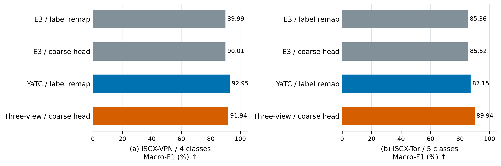
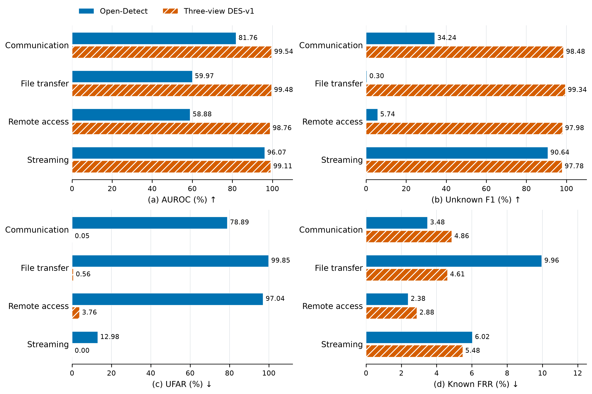
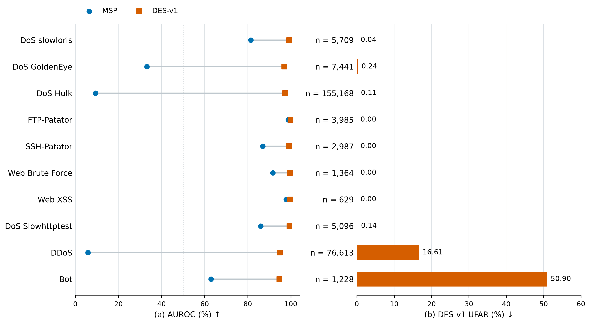

# 4 实验结果与分析

本章围绕已知类别判别、未知类别拒识及各模块的作用开展实验。首先，在服务分类与攻击流量分类任务上比较三视图表示的已知类别识别性能；其次，在VNAT完整服务留出协议下与Open-Detect进行同流配对，并在USTC-TFC2016和CIC-IDS2017上分析不同未知类别的拒识差异；最后，通过同表示分数对照、视图消融、训练策略和阈值敏感性实验，检验第3章的表示学习与经验支撑判定机制。

## 4.1 实验设置

### 4.1.1 数据集与任务划分

实验以双向流为样本单位，使用ISCX-VPN、ISCX-Tor、USTC-TFC2016、CIC-IDS2017和VNAT。各视图共享流标识、标签及训练、验证、测试角色。实验分别考察服务类别判别、完整服务留出及未知攻击识别，各任务采用独立定义的标签空间。

ISCX-VPN与ISCX-Tor分别保留六类、七类原服务标签，用于当前方法与已有方法的闭集对照；另将Chat、Email和VoIP映射为Communication，形成四类、五类粗服务任务。两组任务使用相同的流及角色划分，但适配器和分类头依据对应标签训练。USTC-TFC2016采用A-1、A-2和A-3三种类别留出配置，已知／未知类别数分别为19／1、17／3和15／5，并在原来源划分内按类别确定性抽取10%的流。A-1留出Tinba，A-2留出Geodo、Htbot和Tinba，A-3在A-2基础上增加Miuref和Neris。

CIC-IDS2017设置两类独立实验。已知分类任务包含BENIGN、DoS Slowhttptest和PortScan，并在训练、验证、测试各划分内将BENIGN数量调整为两类攻击数量之和，两类攻击保持各自样本量。未知攻击诊断仅以BENIGN和PortScan为已知类别，使用对应模型评估十类未知攻击。CIC的训练、验证和测试按五分钟采集分组隔离。

VNAT使用23,449条唯一流，将十种应用映射为通信、文件传输、远程访问和流媒体四类服务。通信包括Skype与Zoiper，文件传输包括rsync、scp与sftp，远程访问包括SSH与RDP，流媒体包括Netflix、Vimeo与YouTube。采用完整服务留出协议，每折将一种服务的全部样本作为未知测试集，其余三种服务用于已知训练、验证和测试；已知角色之间保持采集文件与分组互斥。四折分别训练模型，样本组成见表4-1。

**表4-1 VNAT完整服务留出任务的样本组成**

| 未知服务 | 已知训练 | 已知验证 | 已知测试 | 未知测试 |
| --- | ---: | ---: | ---: | ---: |
| 通信 | 17,352 | 2,509 | 1,380 | 2,208 |
| 文件传输 | 14,604 | 2,021 | 954 | 5,870 |
| 远程访问 | 7,705 | 1,129 | 1,008 | 13,607 |
| 流媒体 | 17,693 | 2,531 | 1,461 | 1,764 |

VNAT任务以服务类别为评价单位，各折的应用组成和采集组覆盖沿用冻结划分。

### 4.1.2 实现与训练协议

本方法遵循第3章的分阶段流程：先在已知训练集上微调TrafficFormer与YaTC，并从随机初始化训练TAGCN；随后冻结编码器，训练三路64维高斯适配器；最后固定适配器，以三个均值表示的等比例拼接训练融合映射及分类头。TrafficFormer、TAGCN和YaTC分别训练20、50和200轮，适配器与融合头分别训练30轮。适配器采用视图平均交叉熵与系数为0.05、按64维归一化的平均KL正则；融合头采用交叉熵。优化器、批大小和检查点标准沿用第3章表2。

特征标准化参数、类别经验质心及类内近邻库由已知训练集估计。已知验证集用于选择模型检查点，以及计算分数中位数、MAD和拒识阈值。所有模型和统计量在测试前冻结，测试集仅用于最终评价。

原服务标签闭集对照使用种子2022与2023，编码器种子与适配器、融合头种子对应。当前方法复用各自已训练的编码器和冻结特征，在CPU float32下训练轻量适配器与融合头。其余粗服务、VNAT及未知攻击主结果使用种子2022。双种子结果报告均值与总体标准差；VNAT四折采用不同服务留出任务的等权均值。

### 4.1.3 对比方法

闭集对照包括TrafficFormer、YaTC、Open-Detect、RoNeTC、TFE-GNN和Trident，并保留本文早期TrafficFormer＋FIG/TAGCN双视图版本E3。TrafficFormer和YaTC使用预训练初始化；闭集表中的Open-Detect采用corrected-paper版本，RoNeTC为可运行重建版本。为保持同流样本集合，TFE-GNN采用前至多八个报文并兼容UDP与短流，Trident由前至多八个报文构造86维统计特征。各方法按所述本地实现和相同数据协议进行比较。

主要开集系统基线为Open-Detect Native，其使用32×32字节图、ResNet18变分编码器和128维潜在表示，以样本后验到可学习类别高斯原型的最小前向KL散度作为未知分数。基线从随机初始化训练，并按已知验证集选择检查点；其阈值独立使用已知验证分数的P95。Native版本与闭集corrected-paper版本分别报告。为进一步隔离拒识规则的作用，在本方法相同的冻结128维表示及分类输出上比较MSP、Energy、DES-v0和DES-v1；各分数均独立校准阈值。

### 4.1.4 评价指标与统计口径

已知分类在关闭拒识规则时报告Accuracy、Macro-F1和Weighted-F1。Macro-F1对各类别等权，Weighted-F1按测试样本数加权；二者均与施加拒识后的已知接受率区分。未知检测将未知样本设为正类，报告AUROC、AUPRC、未知类F1、未知误接收率UFAR和已知误拒率Known FRR。AUPRC按平均精确率（Average Precision）计算，未知类F1为已知／未知二分类的正类F1。

设未知测试集为$\mathcal{D}_{U}$、已知测试集为$\mathcal{D}_{K}^{\mathrm{test}}$，则

$$
\operatorname{UFAR}
=\frac{\#\{x\in\mathcal{D}_{U}:s(x)\leq\tau\}}{|\mathcal{D}_{U}|},
\qquad
\operatorname{Known\ FRR}
=\frac{\#\{x\in\mathcal{D}_{K}^{\mathrm{test}}:s(x)>\tau\}}{|\mathcal{D}_{K}^{\mathrm{test}}|}.
$$

主工作点为已知验证分数的P95，采用`higher`分位数规则，且仅当$s(x)>\tau$时输出未知。除原测试池比例外，配对实验还报告在查看分数前按流标识固定的已知／未知1∶1子集。以下指标以百分比报告，差值使用百分点；双种子标准差描述两次运行的数值变化。

## 4.2 已知类别识别性能

### 4.2.1 原服务标签下的同流方法对比

三视图方法在原服务标签下取得八种配置中的最高平均分类指标，说明其完整配置的收益在未合并类别时仍然存在。表4-2使用相同流样本、原标签及2022、2023两个种子，VPN六类与Tor七类的训练／验证／测试流数分别为8,764／1,098／1,093和8,946／1,118／1,117。当前方法复用对应种子的编码器，直接针对原标签训练适配器与融合头。

**表4-2 原服务标签下的八种配置闭集对比（%，种子2022、2023的均值±总体标准差）**

| 方法 | VPN Accuracy ↑ | VPN Macro-F1 ↑ | VPN Weighted-F1 ↑ | Tor Accuracy ↑ | Tor Macro-F1 ↑ | Tor Weighted-F1 ↑ |
| --- | ---: | ---: | ---: | ---: | ---: | ---: |
| TrafficFormer（预训练） | 85.32 ± 0.41 | 86.06 ± 0.40 | 84.74 ± 0.43 | 83.12 ± 0.58 | 82.13 ± 0.64 | 83.24 ± 0.51 |
| YaTC（预训练） | 87.83 ± 1.19 | 88.71 ± 1.16 | 87.65 ± 1.26 | 84.38 ± 0.13 | 82.74 ± 0.08 | 84.36 ± 0.15 |
| Open-Detect（corrected-paper） | 72.87 ± 1.42 | 74.43 ± 1.42 | 72.54 ± 1.35 | 62.85 ± 8.33 | 57.66 ± 9.97 | 61.48 ± 9.13 |
| RoNeTC（重建版） | 70.68 ± 0.69 | 71.57 ± 0.81 | 70.13 ± 0.51 | 60.43 ± 1.07 | 53.40 ± 1.98 | 59.34 ± 1.74 |
| TFE-GNN-8-UDP-short（适配版） | 64.87 ± 1.92 | 65.85 ± 1.46 | 64.45 ± 1.63 | 60.07 ± 0.09 | 55.36 ± 1.38 | 58.81 ± 0.87 |
| Trident-early8-86D（适配版） | 61.34 ± 0.23 | 63.22 ± 0.06 | 60.65 ± 0.05 | 63.29 ± 0.27 | 60.53 ± 0.19 | 63.24 ± 0.33 |
| E3（本文早期双视图版本） | 85.00 ± 0.82 | 85.95 ± 0.70 | 84.64 ± 0.74 | 83.21 ± 0.67 | 82.22 ± 0.76 | 83.39 ± 0.60 |
| 本方法（三视图，原服务标签） | **88.47 ± 0.64** | **89.37 ± 0.55** | **88.36 ± 0.60** | **87.82 ± 0.36** | **86.63 ± 0.15** | **87.88 ± 0.34** |

本方法相对YaTC的平均Macro-F1在VPN和Tor上分别提高0.66和3.89个百分点，相对早期双视图E3分别提高3.42和4.41个百分点。图4-1显示，Tor上的增益大于VPN，且当前方法在两个任务上均取得更高均值。该对照表明，字节图分支及后续适配、融合训练组成的当前配置改善了原服务判别；各分支对未知拒识的具体作用将在第4.4.2节通过受控消融检验。

**图4-1 原服务标签下的闭集方法对比。（a）VPN六类；（b）Tor七类。条形为两个种子的Macro-F1均值，误差线为总体标准差；橙色斜线表示当前三视图方法，灰色表示早期双视图E3。**

### 4.2.2 不同分类任务下的性能

三视图分阶段表示也支持粗服务与多类别攻击流量分类。表4-3报告种子2022下的四项任务，其中USTC使用A-2的17个已知类别，CIC使用三类平衡设置。

**表4-3 当前三视图方法的已知分类结果（%，种子2022）**

| 数据集与任务 | 类别数 | 训练／验证／测试流数 | Accuracy ↑ | Macro-F1 ↑ | Weighted-F1 ↑ |
| --- | ---: | ---: | ---: | ---: | ---: |
| ISCX-VPN，服务分类 | 4 | 8,764／1,098／1,093 | 91.58 | 91.94 | 91.45 |
| ISCX-Tor，服务分类 | 5 | 8,946／1,118／1,117 | 89.62 | 89.94 | 89.67 |
| USTC-TFC2016，A-2已知分类 | 17 | 34,665／4,333／4,333 | 98.43 | 98.76 | 98.43 |
| CIC-IDS2017，三类平衡任务 | 3 | 35,516／3,912／2,536 | 99.80 | 99.75 | 99.80 |

本方法在USTC和CIC上的Macro-F1分别为98.76%和99.75%，在VPN和Tor粗服务任务上分别为91.94%和89.94%。CIC中BENIGN、Slowhttptest和PortScan的类别F1为99.84%、99.62%和99.78%，对应测试样本量为1,268、132和1,136，表明该三类任务的总体高分同时伴随较高的类别平均识别性能。

表4-4在相同粗服务标签和种子下比较已有配置与当前方法。历史预测映射先取原分类头最大概率类别，再映射到粗标签；E3粗分类头在冻结表示上重新学习粗标签，当前方法则训练对应的适配器与融合头。该设置将标签合并的影响与后续监督训练的差别明确区分。

**表4-4 相同粗服务标签下的配置对比（Macro-F1，%，种子2022）**

| 方法 | 粗标签处理方式 | VPN四类 | Tor五类 |
| --- | --- | ---: | ---: |
| E3（早期双视图） | 原分类预测映射 | 89.99 | 85.36 |
| E3（早期双视图） | 冻结表示＋粗分类头 | 90.01 | 85.52 |
| YaTC（预训练） | 原分类预测映射 | **92.95** | 87.15 |
| 本方法（三视图分阶段融合） | 粗标签适配器＋融合分类头 | 91.94 | **89.94** |

相对E3粗分类头，本方法在VPN和Tor上的Macro-F1分别提高1.93和4.42个百分点。相对YaTC预测映射，Tor提高2.79个百分点，VPN低1.01个百分点。当前配置在两项任务上均改善了早期融合结果，同时保留了不同服务任务中的性能差异。结合原标签对照，完整方法的收益既体现在较细的服务判别，也体现在部分粗服务任务，而非仅来自标签合并。

**图4-2 粗服务标签下的同流分类比较。所有配置均使用种子2022；预测映射、冻结表示上的粗分类头及当前适配器＋融合头对应不同训练方式。**

### 4.2.3 服务留出条件下的已知类别保持

在VNAT完整服务留出条件下，本方法仍保持较高的已知类别判别能力。表4-5中，本方法的四折平均Macro-F1为99.87%，Open-Detect为99.58%，两者均能准确识别剩余三个已知服务。相近的已知分类性能使下一节能够进一步检验：系统对已知类别的判别是否同时转化为对未知服务的有效拒识。

**表4-5 VNAT服务留出任务的已知分类性能（%，拒识前）**

| 留出的未知服务 | 已知测试流数 | Open-Detect Macro-F1 | 本方法 Macro-F1 | 本方法 Accuracy |
| --- | ---: | ---: | ---: | ---: |
| 通信 | 1,380 | 99.68 | **100.00** | 100.00 |
| 文件传输 | 954 | **99.69** | **99.69** | 99.69 |
| 远程访问 | 1,008 | 99.41 | **100.00** | 100.00 |
| 流媒体 | 1,461 | 99.53 | **99.79** | 99.86 |
| 四折等权均值 | — | 99.58 | **99.87** | 99.89 |

## 4.3 未知类别拒识性能

### 4.3.1 VNAT完整服务留出对比

在相同VNAT流标识和角色划分下，本方法在四个完整服务留出任务上均取得更高的AUROC和未知类F1。两种方法各自通过已知验证集P95校准阈值，表4-6报告原测试池比例下的配对结果，单元格依次表示Open-Detect／本方法。

**表4-6 VNAT同协议未知检测对比（%，Open-Detect／本方法，P95）**

| 未知服务 | AUROC ↑ | 未知类F1 ↑ | UFAR ↓ | Known FRR ↓ |
| --- | ---: | ---: | ---: | ---: |
| 通信 | 81.76／**99.54** | 34.24／**98.48** | 78.89／**0.05** | **3.48**／4.86 |
| 文件传输 | 59.97／**99.48** | 0.30／**99.34** | 99.85／**0.56** | 9.96／**4.61** |
| 远程访问 | 58.88／**98.76** | 5.74／**97.98** | 97.04／**3.76** | **2.38**／2.88 |
| 流媒体 | 96.07／**99.11** | 90.64／**97.78** | 12.98／**0.00** | 6.02／**5.48** |
| 四折等权均值 | 74.17／**99.22** | 32.73／**98.40** | 72.19／**1.09** | 5.46／**4.45** |

四折平均AUROC由74.17%提高至99.22%，未知类F1由32.73%提高至98.40%，UFAR由72.19%降至1.09%。与此同时，Known FRR均值由5.46%降至4.45%，表明当前协议下的未知拒识改善没有伴随平均已知误拒上升。两种方法的已知分类Macro-F1均超过99%，但开集接收行为差异明显，说明独立拒识评价能够揭示闭集分数未体现的系统差别。

增益主要体现在文件传输和远程访问留出任务：Open-Detect分别误接收99.85%和97.04%的未知流，本方法降至0.56%和3.76%。本方法Known FRR为2.88%至5.48%，通信和远程访问两折略高于Open-Detect，其余两折更低。图4-3同时展示逐折未知检测收益与已知误拒代价，保留平均结果之外的工作点差异。

**图4-3 VNAT完整服务留出下的系统对比。（a）AUROC；（b）未知类F1；（c）UFAR；（d）Known FRR。均使用原测试池和各自已知验证集P95；四折对应不同未知服务，使用种子2022。**

固定1∶1子集仍呈现同方向优势。本方法的平均AUROC、AUPRC和未知类F1分别为99.25%、98.93%和97.32%，Open-Detect分别为74.17%、68.24%和32.02%，表明结果并非仅由原测试池的未知占比驱动。该实验比较表示与拒识模块组成的完整系统；第4.4.1节将固定表示和分类头，只改变未知分数，以进一步定位检测规则的作用。

### 4.3.2 USTC不同未知类别配置

USTC三种留出配置进一步检验本方法在未知攻击类别组成变化时的表现。两方法使用相同来源划分及确定性10%流子集，平衡测试样本在分数评估前固定，阈值各自由已知验证集确定。表4-7分别报告A-1、A-2与A-3的配对结果。

**表4-7 USTC同流未知检测对比（%，Open-Detect／本方法，1∶1子集）**

| 配置 | 已知／未知测试流数 | AUROC ↑ | 未知类F1 ↑ | UFAR ↓ |
| --- | ---: | ---: | ---: | ---: |
| A-1 | 85／85 | **99.07**／97.69 | **96.59**／96.05 | **0.00／0.00** |
| A-2 | 558／558 | 92.90／**94.06** | 50.38／**67.41** | 64.34／**46.06** |
| A-3 | 1,031／1,031 | **97.82**／96.09 | 91.91／**92.31** | 11.25／**9.21** |

本方法在A-2中同时提高AUROC和未知类F1，UFAR降低18.28个百分点；A-3也取得较低UFAR和较高未知类F1。Open-Detect在A-1与A-3的AUROC更高，显示排序收益随类别配置变化。A-2是主要困难场景，本方法仍误接收46.06%的未知流；其中同一批410条Geodo流，Open-Detect漏检337条，本方法漏检257条。该结果体现了对困难类别的改善。

测试比例和已知类别组成共同影响固定阈值表现。A-1的85条未知流均被两方法检出，但本方法在原测试比例下的未知F1约为41.06%，反映少量未知与大量已知并存时误拒对精确率的影响。A-3重新定义已知集合并训练、校准后，同批Geodo的漏检情况发生变化。因此，未知类别数量之外，已知集合的组成也是评价拒识难度的重要条件。

**图4-4 USTC三种类别留出配置的配对比较。（a）AUROC；（b）未知类F1；（c）UFAR。使用固定1∶1测试子集、种子2022及各自已知验证集P95，横轴标明已知／未知测试样本数。**

### 4.3.3 CIC不同未知攻击的响应

CIC实验进一步将未知服务拒识扩展为固定模型对多种未知攻击的诊断。保持BENIGN＋PortScan模型、训练支撑库、P95阈值及2,272条已知测试流不变，逐类加入十种攻击。表4-8同时保留低误接收与较难拒识的类别，以分析同一检测器的响应范围。

**表4-8 CIC十类未知攻击的识别结果（%，原测试池比例，P95）**

| 未知攻击 | 未知流数 | MSP AUROC | DES-v1 AUROC | DES-v1 AUPRC | DES-v1 UFAR ↓ |
| --- | ---: | ---: | ---: | ---: | ---: |
| DoS slowloris | 5,709 | 81.47 | **99.31** | 99.67 | 0.04 |
| DoS GoldenEye | 7,441 | 33.17 | **97.00** | 97.72 | 0.24 |
| DoS Hulk | 155,168 | 9.38 | **97.38** | 99.88 | 0.11 |
| FTP-Patator | 3,985 | 98.75 | **99.83** | 99.86 | 0.00 |
| SSH-Patator | 2,987 | 86.97 | **99.13** | 98.93 | 0.00 |
| Web Attack – Brute Force | 1,364 | 91.61 | **99.57** | 99.14 | 0.00 |
| Web Attack – XSS | 629 | 97.80 | **99.75** | 98.84 | 0.00 |
| DoS Slowhttptest | 5,096 | 85.97 | **99.34** | 99.63 | 0.14 |
| DDoS | 76,613 | 5.82 | **94.90** | 99.45 | 16.61 |
| Bot | 1,228 | 62.91 | **94.64** | 87.58 | 50.90 |

DES-v1在十类攻击中的八类上取得不超过0.24%的UFAR，所有评估共享7.13%的Known FRR。Hulk的MSP AUROC为9.38%，DES-v1为97.38%，说明训练支撑距离在分类置信度排序失效时仍能提供区分信息。Bot与DDoS的UFAR分别为50.90%和16.61%，是同一冻结模型下最突出的失效类别。

FTP-Patator、SSH-Patator、Web Brute Force和XSS在本次测试中均无未知误接收。DDoS虽有99.45%的AUPRC，但其未知占比为97.12%，仍对应16.61%的UFAR，显示平均排序指标与固定工作点的互补性。slowloris、GoldenEye与Hulk在固定1∶1子集上的AUPRC分别为99.18%、93.07%和92.81%。这些结果促使后续分析同时考察分数机制、阈值及未知组成，而非仅以单项高分概括检测性能。

**图4-5 CIC十类未知攻击的检测差异。（a）MSP与DES-v1的AUROC；（b）DES-v1的UFAR及未知样本数。所有攻击共享已知测试流和冻结阈值；保留Bot、DDoS等困难类别。**

## 4.4 模块消融与训练策略

### 4.4.1 局部支撑改善未知拒识

为区分完整系统收益与拒识规则的贡献，固定VNAT四折的编码器、融合特征$h(x)$及分类输出$\ell(x)$，仅更换未知分数。MSP和Energy使用分类输出，DES-v0使用最近经验质心平方距离，DES-v1进一步结合最近质心类别内的10近邻欧氏距离均值。各分数独立使用已知验证集校准阈值，表4-9给出结果。

**表4-9 相同冻结表示上的拒识分数对比（%，四折等权平均，原测试池比例，P95）**

| 拒识分数 | AUROC ↑ | AUPRC ↑ | 未知类F1 ↑ | UFAR ↓ | Known FRR ↓ |
| --- | ---: | ---: | ---: | ---: | ---: |
| MSP | 91.83 | 96.66 | 90.55 | 14.63 | 4.93 |
| Energy | 91.73 | 96.58 | 89.96 | 15.40 | 4.87 |
| DES-v0（仅经验质心） | 97.43 | 98.79 | 96.10 | 5.59 | 4.87 |
| **DES-v1（全局＋局部）** | **99.22** | **99.50** | **98.40** | **1.09** | **4.45** |

局部近邻信息在固定表示上进一步改善了未知检测。相较DES-v0，DES-v1将平均AUROC从97.43%提高至99.22%，UFAR从5.59%降至1.09%，Known FRR从4.87%降至4.45%。四折AUROC均提高，其中远程访问由94.47%提高至98.76%，通信由98.24%提高至99.54%。该对照为第3章全局与局部经验支撑的组合设计提供了直接实验依据：局部真实样本邻域补充了类别均值之外的拒识信息。

文件传输一折进一步展示了两种错误率的取舍：DES-v1将Known FRR从5.03%降至4.61%，同时UFAR由0.36%升至0.56%。因此，局部支撑的收益主要表现为四折排序及平均接收行为的改善，具体工作点仍需结合已知业务误拒和未知误接收共同评价。

**图4-6 相同三视图表示上的拒识分数消融。列为四种未知服务，行对应四种分数；依次报告AUROC、UFAR和Known FRR，单元格均为百分比。**

### 4.4.2 视图贡献与工作点取舍

为检验各分支对最终表示的贡献，在相同VNAT四折上，分别训练完整模型、去FIG、去YaTC和去TrafficFormer的融合头。编码器、高斯适配器及标准化参数保持冻结；三个64维槽、1／3缩放和192→128→128→C头结构保持一致，缺失分支填零。每折四个头使用相同初始化、批次顺序及30轮预算，共完成16个头，并依据已知验证Macro-F1选模。

**表4-10 VNAT同配置视图消融（%，四折等权平均，DES-v1，原测试池比例，P95）**

| 配置 | 已知Macro-F1 ↑ | AUROC ↑ | AUPRC ↑ | 未知类F1 ↑ | UFAR ↓ | Known FRR ↓ |
| --- | ---: | ---: | ---: | ---: | ---: | ---: |
| 完整三视图 | 99.87 | 99.22 | 99.50 | 98.40 | 1.09 | 4.45 |
| 去FIG | 99.89 | 99.45 | 99.77 | 98.64 | 1.41 | 2.49 |
| 去YaTC | 99.87 | 96.92 | 98.75 | 89.83 | 14.80 | 4.91 |
| 去TrafficFormer | 99.74 | 98.35 | 98.81 | 94.14 | 8.53 | 4.81 |

YaTC与TrafficFormer均提供了其余分支难以完全替代的拒识信息。移除两者分别使四折平均UFAR由1.09%升至14.80%和8.53%，且四折AUROC均下降。远程访问留出时，去YaTC后的已知Macro-F1仍为100%，但AUROC从98.76%降至91.40%，UFAR从3.76%升至42.75%；文件传输留出时，去TrafficFormer使UFAR从0.56%升至24.97%。这表明，闭集性能接近时，分支对未知拒识的贡献仍可能存在明显差异。

FIG的作用体现为任务与工作点之间的取舍。去FIG在三折提高AUROC，在文件传输一折降低AUROC；平均AUROC由99.22%升至99.45%，Known FRR由4.45%降至2.49%，同时UFAR由1.09%升至1.41%。完整三视图与TrafficFormer＋YaTC因此在不同指标上各有优势，FIG的作用随未知服务和工作点变化。

### 4.4.3 分阶段与联合训练

除视图组成外，训练方式也会影响融合表示。为考察当前分阶段配方，在相同VPN四类、Tor五类测试流及种子2022下，与20轮端到端联合训练进行比较；两者均按已知验证Macro-F1选择检查点，结果见表4-11。

**表4-11 已知分类的训练策略对比（%，种子2022）**

| 数据集 | 联合训练Accuracy | 分阶段训练Accuracy | 联合训练Macro-F1 | 分阶段训练Macro-F1 | Macro-F1提升／百分点 |
| --- | ---: | ---: | ---: | ---: | ---: |
| ISCX-VPN | 87.83 | **91.58** | 88.22 | **91.94** | +3.72 |
| ISCX-Tor | 84.78 | **89.62** | 85.32 | **89.94** | +4.62 |

当前分阶段配方在VPN和Tor上的Macro-F1分别高3.72和4.62个百分点。VPN中分阶段正确、联合错误的样本为62条，反向为21条；Tor分别为109条和55条，逐样本差异与总体指标方向一致。该比较支持本实验采用的分阶段训练方案；由于训练预算与优化过程不同，所观察的差值对应整体配方效果。

## 4.5 工作点与测试分布敏感性

### 4.5.1 拒识阈值的影响

前述结果采用固定P95工作点。本节保持VNAT网络、训练支撑库及分数不变，以已知验证分数的P90和P99作为补充工作点，观察误接收与误拒的变化。表4-12使用已有四折结果，P95保持为主工作点。

**表4-12 VNAT的验证分位数阈值敏感性（%，DES-v1，四折等权平均，原测试池比例）**

| 验证分位数 | 未知类F1 ↑ | UFAR ↓ | Known FRR ↓ |
| --- | ---: | ---: | ---: |
| P90 | 97.26 | 0.91 | 10.02 |
| P95 | 98.40 | 1.09 | 4.45 |
| P99 | 85.94 | 20.98 | 1.23 |

验证分位数直接控制了已知接受与未知漏识之间的取舍。P90将平均UFAR降至0.91%，Known FRR升至10.02%；P99将Known FRR降至1.23%，UFAR升至20.98%。阈值越宽松，已知接受率越高，未知漏识也可能增多。三个工作点共享同一分数，AUROC与AUPRC保持不变，说明固定阈值错误率能够补充排序指标对接收行为的描述。

### 4.5.2 未知比例与类别组成

阈值敏感性考察同一分布下的接受标准，混合测试进一步考察测试样本组成的影响。在CIC十类攻击的冻结分数池上，每次抽取2,000条流，并采用20个确定性种子重复。已知／未知各半、十类未知均衡时，DES-v1平均AUROC为98.10%，未知类F1为93.12%，UFAR为6.71%，Known FRR为7.07%。模型与P95阈值全程保持冻结。

未知数量比例变化下，当前分数仍保持较稳定的排序和条件错误率。保持十类未知内部均衡，已知∶未知由9∶1变为1∶9时，AUROC为98.04%至98.13%，UFAR为6.73%至6.95%；AUPRC则随未知占比增加由85.26%升至99.73%。相比之下，固定1∶1比例但仅混合Bot与DDoS时，UFAR升至33.84%。正常与PortScan的组成变化也会影响Known FRR。结合逐攻击结果，相较于未知数量比例，当前检测器对未知类别组成的变化更敏感；混合平均值应与类别级错误率共同报告。

**图4-7 CIC冻结分数池的比例与组成敏感性。（a）不同未知占比的AUROC与AUPRC；（b）对应UFAR与Known FRR；（c）固定1∶1比例下的不同未知组成。每个点或条形为20次抽样均值，不表示20次模型训练。**

## 4.6 讨论与适用范围

实验从已知分类和未知拒识两个层面评价了本方法。首先，当前三视图配置在原服务标签闭集对照中取得最高平均分类指标，收益并非仅由标签合并产生。其次，在VNAT完整服务留出任务上，本方法较Open-Detect减少未知误接收，同时保持较低的平均已知误拒。最后，同表示分数对照直接支持局部近邻对类别质心的补充作用；视图消融则显示YaTC与TrafficFormer提供拒识信息，FIG体现出指标与任务间的取舍。

方法表现随未知任务变化。此前VPN应用级未知实验中，DES-v1的AUROC为55.95%、UFAR为85.55%；Tor对应为92.49%和63.48%。VPN通信服务整体留出设置的已知Macro-F1为99.55%，但AUROC为40.52%、UFAR为84.94%。这些结果与Geodo、Bot和DDoS的困难表现共同说明，较好的已知判别不能替代未知拒识验证。完整服务留出、服务内新应用及未知攻击分别对应不同的评价问题。

实验结论限定于所列冻结协议。VNAT等数据曾参与方法开发，主开集实验采用单个训练种子；服务折反映任务变化，固定分数池重复反映抽样变化。ISCX标签主要由采集场景导出，VNAT的应用和采集组覆盖不均衡，CIC还存在日期、采集文件及端点因素。

完整系统比较包含表示、预训练和拒识规则的共同差异，高斯适配、KL正则和融合头结构的单独贡献仍需专门消融验证。已知验证集同时用于选模和经验阈值校准，因此P95及有限样本上的零误接收均不提供未来分布的错误率保证。外部预训练覆盖、加密状态与跨环境泛化，以及端到端吞吐和延迟，属于进一步评价的范围。
