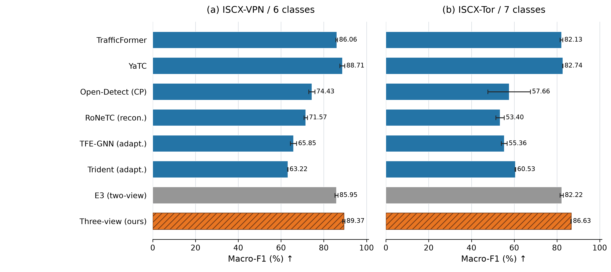
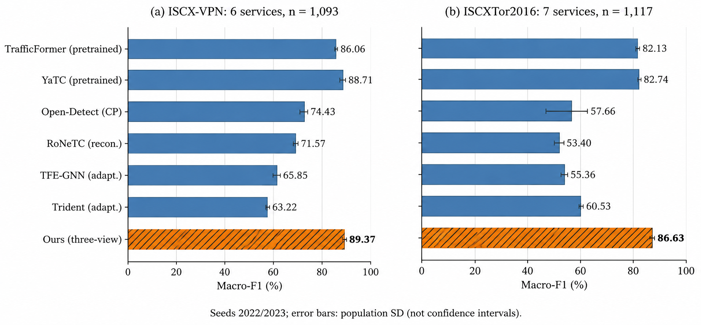
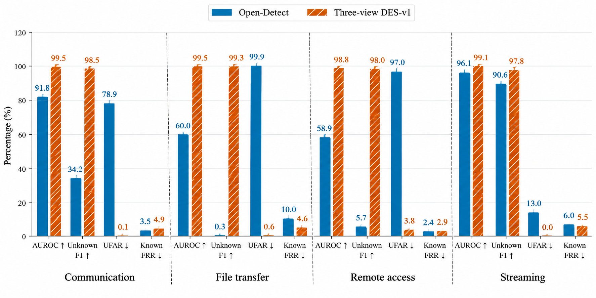
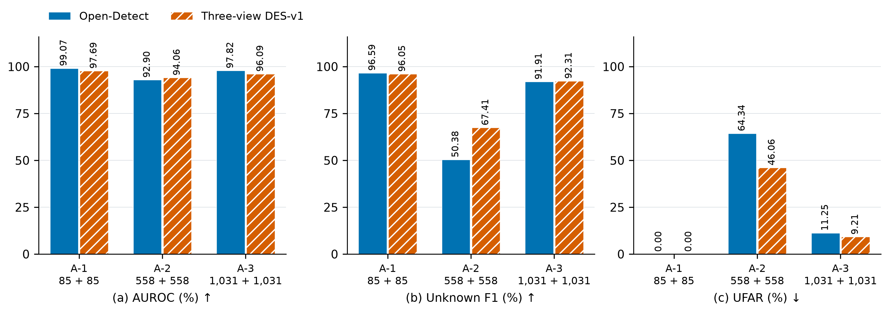
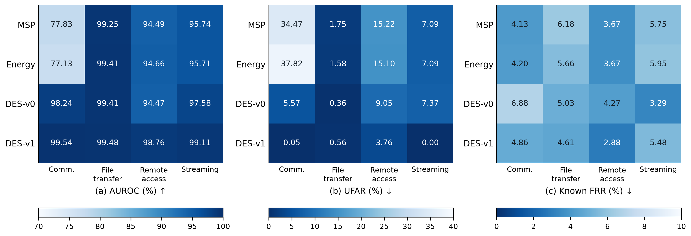
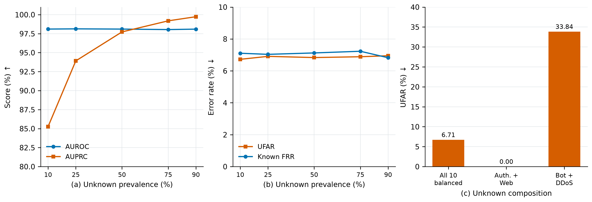

# 4 实验结果与分析

本节在多个数据集和不同任务设置下，对方法进行系统评估，主要验证以下三个方面：

1) **已知类别识别性能。** 在服务分类与攻击流量分类任务中，将三视图表示与现有方法进行对比，评估所提出方法在不同标签粒度下的已知类别判别能力。

2) **未知类别拒识性能。** 评估所提出方法对未知服务及未知攻击的拒识能力。

3) **关键模块与判定机制的有效性。** 分析各视图、局部经验支撑信息对检测性能的影响，并考察不同未知类别比例和类别组成下的性能变化。

## 4.1 实验设置

### 4.1.1 数据集与任务划分

实验以双向流为样本单位，使用ISCX-VPN、ISCX-Tor、USTC-TFC2016、CIC-IDS2017和VNAT。

ISCX-VPN与ISCX-Tor分别保留六类、七类原服务标签，用于当前方法与已有方法的闭集对照；另将Chat、Email和VoIP映射为Communication，形成四类、五类粗服务任务。两组任务使用相同的流及角色划分，但适配器和分类头依据对应标签训练。USTC-TFC2016采用A-1、A-2和A-3三种类别留出配置，已知／未知类别数分别为19／1、17／3和15／5，并在原来源划分内按类别确定性抽取10%的流。A-1留出Tinba，A-2留出Geodo、Htbot和Tinba，A-3在A-2基础上增加Miuref和Neris。

**表4-1 USTC-TFC2016、ISCX-VPN和ISCX-Tor类别及ID映射**

| ID | Class | ID | Class | ID | Class | ID | Class | ID | Class |
|:---:|:---:|:---:|:---:|:---:|:---:|:---:|:---:|:---:|:---:|
| U0 | Gmail | U7 | SMB | U14 | MySQL | V0 | Chat | T0 | Chat |
| U1 | FTP | U8 | BitTorrent | U15 | Htbot | V1 | Email | T1 | Email |
| U2 | Nsis-ay | U9 | WorldOfWarcraft | U16 | Tinba | V2 | File Transfer | T2 | File Transfer |
| U3 | Facetime | U10 | Shifu | U17 | Skype | V3 | P2P | T3 | P2P |
| U4 | Weibo | U11 | Outlook | U18 | Miuref | V4 | Streaming | T4 | Audio-streaming |
| U5 | Cridex | U12 | Virut | U19 | Neris | V5 | VoIP | T5 | Video-streaming |
| U6 | Zeus | U13 | Geodo | — | — | — | — | T6 | VoIP |

**注：** U 表示 USTC-TFC2016，V 表示 ISCX-VPN，T 表示 ISCX-Tor。

**表4-2 实验场景与已知／未知类别划分**

| Scenario | Known Classes (KC) | Unknown Classes (UC) |
|---|---|---|
| A-1 | USTC-TFC2016 \ {U16} | U16 (Tinba) |
| A-2 | USTC-TFC2016 \ {U13, U15, U16} | U13 (Geodo), U15 (Htbot), U16 (Tinba) |
| A-3 | USTC-TFC2016 \ {U13, U15, U16, U18, U19} | U13 (Geodo), U15 (Htbot), U16 (Tinba), U18 (Miuref), U19 (Neris) |
| VPN-4C | {V0+V1+V5, V2, V3, V4} | None (closed-set) |
| Tor-5C | {T0+T1+T6, T2, T3, T4, T5} | None (closed-set) |

CIC-IDS2017设置两类独立实验。已知分类任务包含BENIGN、DoS Slowhttptest和PortScan，未知攻击诊断仅以BENIGN和PortScan为已知类别，使用对应模型评估十类未知攻击。

VNAT将十种应用映射为通信、文件传输、远程访问和流媒体四类服务。通信包括Skype与Zoiper，文件传输包括rsync、scp与sftp，远程访问包括SSH与RDP，流媒体包括Netflix、Vimeo与YouTube。

**表4-3 VNAT完整服务留出实验的样本组成**

| 留出未知服务 | 已知流量数 | 未知流量数 |
|:---:|---:|---:|
| 通信 | 21,241 | 2,208 |
| 文件传输 | 17,579 | 5,870 |
| 远程访问 | 9,842 | 13,607 |
| 流媒体 | 21,685 | 1,764 |

VNAT任务以服务类别为评价单位，各折的应用组成和采集组覆盖沿用冻结划分。

### 4.1.2 实现细节

本方法先在已知训练集上训练编码器与高斯适配器，以三个均值表示的等比例拼接训练融合映射及分类头。具体的训练配置如表4-4所示：

**表4-4 模型训练参数配置**

| 部件 | 初始化方式 | 轮数／批大小 | 优化器与学习率 |
|:---:|:---:|:---:|:---:|
| TrafficFormer | 预训练权重 | 20／64 | AdamW；6×10⁻⁵ |
| TAGCN | 随机初始化 | 50／64 | Adam；1×10⁻³ |
| YaTC | 预训练权重 | 200／64 | AdamW；5×10⁻⁴ |
| 三路高斯适配器 | 随机初始化 | 30／256 | Adam；1×10⁻³ |
| 融合映射及分类头 | 随机初始化 | 30／256 | Adam；1×10⁻³ |

**注：** 高斯适配器输出64维表示，采用交叉熵损失与KL正则联合优化，KL正则系数为0.05，并按特征维度归一化；融合映射及分类头采用交叉熵损失。

### 4.1.3 对比方法

为验证所提出方法的有效性，本文选取多种具有代表性的加密流量识别方法进行对比，涵盖闭集分类与未知类别检测两类任务。各对比方法介绍如下：

**（1）用于闭集分类性能对比的方法：**

- **TrafficFormer：** 基于Transformer架构，通过注意力机制学习网络流量的上下文特征，实现加密流量分类。
- **YaTC：** 利用自监督预训练学习网络流量的通用特征表示，并通过下游任务微调实现流量类别识别。
- **Open-Detect：** 基于变分自编码器与高斯类别原型，通过生成约束和判别约束增强类内紧凑性与类间可分性。
- **RoNeTC：** 面向加密流量分类的深度学习方法，通过学习流量特征实现类别判别。
- **TFE-GNN：** 将网络流量构建为图结构，利用图神经网络提取流量交互特征并完成分类。
- **Trident：** 基于流量统计特征构建分类模型，利用流量行为信息进行细粒度类别识别。

**（2）未知类别检测方法：**

- **Open-Detect Native：** 采用变分编码器学习流量的潜在概率分布，并通过样本后验分布与类别高斯原型之间的最小KL散度识别未知类别。
- **MSP：** 基于分类器输出的最大Softmax概率衡量预测置信度，将低置信度样本判定为未知类别。
- **Energy：** 根据分类器输出的Logits计算能量分数，利用已知与未知样本的分数差异实现拒识。
- **DES-v0：** 基于已知类别的经验质心构建距离分数，衡量待测样本与已知类别特征分布的偏离程度。
- **DES-v1：** 在经验质心的基础上进一步引入类内近邻支撑信息，综合评估样本与已知类别的局部特征一致性。

其中，MSP、Energy、DES-v0和DES-v1均基于相同的冻结融合特征与分类输出进行评估，并使用已知验证集独立校准拒识阈值，以保证不同拒识策略之间的比较公平性。

### 4.1.4 评价指标与统计口径

已知类别分类采用Accuracy、Macro-F1和Weighted-F1评价模型的分类性能。其中，Macro-F1对各类别等权计算，Weighted-F1按照各类别样本数量加权计算。未知类别检测采用AUROC、AUPRC、未知类F1、未知误接收率（UFAR）和已知误拒率（Known FRR）进行评价。其中，将未知类别视为正类，AUROC和AUPRC分别衡量模型对未知类别的整体排序能力和精确率-召回率表现，未知类F1反映固定阈值下未知类别的综合识别性能。

设未知测试集为$D_U$，已知测试集为$D_K^{test}$，未知检测分数为$s(x)$，拒识阈值为$\tau$，则：

$$
\mathrm{UFAR}=
\frac{|\{x\in D_U:s(x)\leq\tau\}|}{|D_U|},
$$

$$
\mathrm{Known\ FRR}=
\frac{|\{x\in D_K^{test}:s(x)>\tau\}|}{|D_K^{test}|}.
$$

其中，UFAR表示未知流量被错误接受为已知类别的比例，Known FRR表示已知流量被错误拒识的比例。本文采用已知验证集检测分数的第95百分位数（P95）作为主拒识阈值，使用higher分位数规则确定阈值，并统一规定当$s(x)>\tau$时判定为未知类别。阈值敏感性实验进一步采用P90和P99作为补充工作点。

此外，部分配对实验按照预先固定的流标识构建已知／未知1∶1测试子集，以考察测试样本比例对检测结果的影响。AUPRC采用平均精确率计算。

## 4.2 已知类别识别性能

已知类别的准确识别是实现未知流量有效拒识的重要基础。为评估本方法对不同类型加密流量的分类能力，首先在四个数据集的原始服务标签下开展闭集分类实验，并与六种代表性方法进行对比。

**表4-5 原服务标签下的闭集分类性能对比**

| 方法 | VPN Accuracy ↑ | VPN Macro-F1 ↑ | VPN Weighted-F1 ↑ | Tor Accuracy ↑ | Tor Macro-F1 ↑ | Tor Weighted-F1 ↑ |
| --- | ---: | ---: | ---: | ---: | ---: | ---: |
| TrafficFormer | 85.32 ± 0.41 | 86.06 ± 0.40 | 84.74 ± 0.43 | 83.12 ± 0.58 | 82.13 ± 0.64 | 83.24 ± 0.51 |
| YaTC | 87.83 ± 1.19 | 88.71 ± 1.16 | 87.65 ± 1.26 | 84.38 ± 0.13 | 82.74 ± 0.08 | 84.36 ± 0.15 |
| Open-Detect | 72.87 ± 1.42 | 74.43 ± 1.42 | 72.54 ± 1.35 | 62.85 ± 8.33 | 57.66 ± 9.97 | 61.48 ± 9.13 |
| RoNeTC | 70.68 ± 0.69 | 71.57 ± 0.81 | 70.13 ± 0.51 | 60.43 ± 1.07 | 53.40 ± 1.98 | 59.34 ± 1.74 |
| TFE-GNN | 64.87 ± 1.92 | 65.85 ± 1.46 | 64.45 ± 1.63 | 60.07 ± 0.09 | 55.36 ± 1.38 | 58.81 ± 0.87 |
| Trident | 61.34 ± 0.23 | 63.22 ± 0.06 | 60.65 ± 0.05 | 63.29 ± 0.27 | 60.53 ± 0.19 | 63.24 ± 0.33 |
| 本方法 | **88.47 ± 0.64** | **89.37 ± 0.55** | **88.36 ± 0.60** | **87.82 ± 0.36** | **86.63 ± 0.15** | **87.88 ± 0.34** |

本方法相对YaTC的平均Macro-F1在VPN和Tor上分别提高0.66和3.89个百分点。图4-1显示，Tor上的增益大于VPN，且当前方法在两个任务上均取得更高均值。该对照表明，字节图分支及后续适配、融合训练组成的当前配置改善了原服务判别；各分支对未知拒识的具体作用将在第4.4.2节通过受控消融检验。

**图4-1 原服务标签下的闭集方法对比。（a）VPN六类；（b）Tor七类。条形为两个种子的Macro-F1均值，误差线为总体标准差；橙色斜线表示当前三视图方法，灰色表示早期双视图E3。**

为进一步考察本方法在不同标签粒度和任务类型下的适用性，本文在 VPN 四类粗服务任务、Tor 五类粗服务任务、USTC-TFC2016 十七类已知分类任务以及 CIC-IDS2017 三类平衡分类任务上开展补充实验。表4-6汇总了本方法在上述任务中的分类结果。

**表4-6 当前三视图方法的已知分类结果（%）**

| 数据集与任务 | 类别数 | 训练／验证／测试流数 | Accuracy ↑ | Macro-F1 ↑ | Weighted-F1 ↑ |
| --- | ---: | ---: | ---: | ---: | ---: |
| ISCX-VPN，服务分类 | 4 | 8,764／1,098／1,093 | 91.58 | 91.94 | 91.45 |
| ISCX-Tor，服务分类 | 5 | 8,946／1,118／1,117 | 89.62 | 89.94 | 89.67 |
| USTC-TFC2016，A-2已知分类 | 17 | 34,665／4,333／4,333 | 98.43 | 98.76 | 98.43 |
| CIC-IDS2017，三类平衡任务 | 3 | 35,516／3,912／2,536 | 99.80 | 99.75 | 99.80 |

本方法在USTC和CIC上的Macro-F1分别为98.76%和99.75%，在VPN和Tor粗服务任务上分别为91.94%和89.94%。CIC中BENIGN、Slowhttptest和PortScan的类别F1为99.84%、99.62%和99.78%，表明该三类任务的总体高分同时伴随较高的类别平均识别性能。

除上述分类任务外，本文进一步在 VNAT 完整服务留出协议下考察本方法对已知服务的分类能力。每折将一种完整服务作为未知类别，其余三种服务作为已知类别，分别训练并评估模型。该实验能够在模拟未知服务出现的条件下，检验本方法对剩余已知服务的判别能力，并为下一节的未知类别拒识对比建立参照。表4-4汇总了四折实验中已知测试流量的分类结果。

**表4-7 VNAT 服务留出任务的已知类别识别性能（%，拒识前）**

| 留出的未知服务 | 已知测试流数 | Open-Detect Macro-F1 | 本方法 Macro-F1 | 本方法 Accuracy |
| :--- | ---: | ---: | ---: | ---: |
| 通信 | 1,380 | 99.68 | **100.00** | 100.00 |
| 文件传输 | 954 | **99.69** | **99.69** | 99.69 |
| 远程访问 | 1,008 | 99.41 | **100.00** | 100.00 |
| 流媒体 | 1,461 | 99.53 | **99.79** | 99.86 |
| 四折等权均值 | — | 99.58 | **99.87** | 99.89 |

表4-7中，本方法的四折平均Macro-F1为99.87%，Open-Detect为99.58%，均表现出较高的已知类别识别性能，为进一步考察已知类别判别能力能否转化为对未知服务的有效拒识提供了基础。

## 4.3 未知类别拒识性能

闭集分类性能无法充分反映模型对未知流量的拒识能力。因此，本文在VNAT、USTC-TFC2016和CIC-IDS2017上开展开集检测实验，评估模型的未知类别识别能力及其在不同类别留出场景下的表现。

**整体拒识性能对比。** 为评估模型在完整服务留出条件下的未知类别检测能力，本文在VNAT数据集上将本方法与Open-Detect进行比较。图4-2展示了两种方法在四种未知服务场景下的AUROC、未知类F1、UFAR和Known FRR。

![图4-2 VNAT完整服务留出实验中两种方法的未知类别检测性能对比]

**图4-2 VNAT完整服务留出实验中两种方法的未知类别检测性能对比。（a）AUROC；（b）未知类F1；（c）UFAR；（d）Known FRR。**

图4-2显示，本方法在四种服务留出场景下的AUROC和未知类F1均高于Open-Detect。其中文件传输场景的AUROC和未知类F1分别由59.97%和0.30%提升至99.48%和99.34%，远程访问场景分别由58.88%和5.74%提升至98.76%和97.98%。四折平均UFAR由72.19%降至1.09%，Known FRR由5.46%降至4.45%。尽管通信和远程访问场景的Known FRR略有上升，但整体误拒率有所降低，表明本方法能够有效改善未知服务拒识性能。

为排除测试集中已知／未知样本比例的影响，本文进一步在预先固定的1∶1配对子集上进行评估。本方法的平均AUROC、AUPRC和未知类F1分别达到99.25%、98.93%和97.32%，均高于Open-Detect的74.17%、68.24%和32.02%，表明本方法的检测优势并非仅由测试集类别比例差异造成。

**不同未知类别配置下的拒识表现。** 为考察未知类别数量及组成变化对模型拒识性能的影响，本文在USTC-TFC2016上设置A-1、A-2和A-3三种类别留出场景，实验结果如图4-4所示。

从图4-3可以看出，本方法在A-2和A-3场景下均取得更高的未知类F1和更低的UFAR。其中，A-2场景下未知类F1由50.38%提高至67.41%，UFAR由64.34%降至46.06%；A-3场景下，未知类F1由91.91%提高至92.31%，UFAR由11.25%降至9.21%。A-1场景下，两种方法的UFAR均为0，表现较为接近。总体而言，本方法在多种未知类别配置下表现出较好的拒识能力，尤其在多未知类别场景中，相较于Open-Detect具有更明显的性能优势。

**图4-3 USTC三种类别留出配置下的未知类别检测性能对比。（a）AUROC；（b）未知类F1；（c）UFAR。**

**不同未知攻击的类别级响应。** 为进一步分析拒识性能在攻击类别之间的差异，CIC-IDS2017实验固定以BENIGN和PortScan训练的模型、训练支撑库、P95阈值及2,272条已知测试流，逐类加入十种未知攻击。表4-8同时报告MSP和DES-v1的AUROC，以及DES-v1的AUPRC和UFAR，以对比传统分类置信度与经验支撑分数在不同未知攻击上的表现。

**表4-8 CIC十类未知攻击的识别结果（%，原测试池比例，P95）**

| 未知攻击 | 未知流数 | MSP AUROC | DES-v1 AUROC | DES-v1 AUPRC | DES-v1 UFAR ↓ |
| --- | ---: | ---: | ---: | ---: | ---: |
| DoS slowloris | 5,709 | 81.47 | **99.31** | 99.67 | 0.04 |
| DoS GoldenEye | 7,441 | 33.17 | **97.00** | 97.72 | 0.24 |
| DoS Hulk | 155,168 | 9.38 | **97.38** | 99.88 | 0.11 |
| FTP-Patator | 3,985 | 98.75 | **99.83** | 99.86 | 0.00 |
| SSH-Patator | 2,987 | 86.97 | **99.13** | 98.93 | 0.00 |
| Web Attack – Brute Force | 1,364 | 91.61 | **99.57** | 99.14 | 0.00 |
| Web Attack – XSS | 629 | 97.80 | **99.75** | 98.84 | 0.00 |
| DoS Slowhttptest | 5,096 | 85.97 | **99.34** | 99.63 | 0.14 |
| DDoS | 76,613 | 5.82 | **94.90** | 99.45 | 16.61 |
| Bot | 1,228 | 62.91 | **94.64** | 87.58 | 50.90 |

DES-v1在十类未知攻击中的八类上取得了不超过0.24%的UFAR，整体拒识效果较好，所有攻击类别对应的Known FRR为7.13%。其中，在Hulk攻击检测中，MSP的AUROC仅为9.38%，而DES-v1达到97.38%，表明经验支撑距离能够有效弥补分类置信度在部分未知攻击识别中的不足。相比之下，Bot和DDoS仍是较难识别的类别，其UFAR分别达到50.90%和16.61%，说明不同攻击类型与已知类别之间的特征重叠程度会影响拒识效果。

值得注意的是，DDoS的AUPRC达到99.45%，但其在原测试池中的未知样本占比高达97.12%，同时UFAR仍为16.61%。这表明在类别分布不均衡的情况下，较高的AUPRC并不意味着固定阈值下具有较低的误接收率。因此，需要结合排序指标与阈值相关指标综合评价模型的拒识性能。结合VNAT和USTC的实验结果可以看出，本方法在整体未知检测和多数类别识别中均表现出较好的性能，但对部分特征分布与已知类别存在重叠的未知攻击仍有进一步改进空间。

## 4.4 拒识机制与多模块消融

### 4.4.1 全局与局部经验支撑的作用

为区分完整系统收益与拒识规则的贡献，固定VNAT四折的编码器、融合特征$h(x)$及分类输出$\ell(x)$，仅更换未知分数。MSP和Energy使用分类输出，DES-v0使用最近经验质心平方距离，DES-v1进一步结合最近质心类别内的10近邻欧氏距离均值。各分数独立使用已知验证集校准阈值，表4-9给出结果。

**表4-9 相同冻结表示上的拒识分数对比（%，四折等权平均，原测试池比例，P95）**

| 拒识分数 | AUROC ↑ | AUPRC ↑ | 未知类F1 ↑ | UFAR ↓ | Known FRR ↓ |
| --- | ---: | ---: | ---: | ---: | ---: |
| MSP | 91.83 | 96.66 | 90.55 | 14.63 | 4.93 |
| Energy | 91.73 | 96.58 | 89.96 | 15.40 | 4.87 |
| DES-v0（仅经验质心） | 97.43 | 98.79 | 96.10 | 5.59 | 4.87 |
| **DES-v1（全局＋局部）** | **99.22** | **99.50** | **98.40** | **1.09** | **4.45** |

局部近邻信息在固定表示上进一步改善了未知检测。相较DES-v0，DES-v1将平均AUROC从97.43%提高至99.22%，UFAR从5.59%降至1.09%，Known FRR从4.87%降至4.45%。四折AUROC均提高，其中远程访问由94.47%提高至98.76%，通信由98.24%提高至99.54%。该对照为第3章全局与局部经验支撑的组合设计提供了直接实验依据：局部真实样本邻域补充了类别均值之外的拒识信息。

文件传输一折进一步展示了两种错误率的取舍：DES-v1将Known FRR从5.03%降至4.61%，同时UFAR由0.36%升至0.56%。因此，局部支撑的收益主要表现为四折排序及平均接收行为的改善，具体工作点仍需结合已知业务误拒和未知误接收共同评价。

**图4-4 相同三视图表示上的拒识分数消融。列为四种未知服务，行对应四种分数；依次报告AUROC、UFAR和Known FRR，单元格均为百分比。**

### 4.4.2 视图贡献

为检验各分支对最终表示的贡献，本文在相同VNAT四折设置下开展视图消融实验，分别移除FIG、YaTC和TrafficFormer分支。实验过程中，编码器、高斯适配器及标准化参数保持冻结，融合头结构与训练配置保持一致，以保证不同配置之间的可比性。表4-10给出了各配置下的闭集分类与未知检测结果。

**表4-10 VNAT同配置视图消融（%，四折等权平均，DES-v1，原测试池比例，P95）**

| 配置 | 已知Macro-F1 ↑ | AUROC ↑ | AUPRC ↑ | 未知类F1 ↑ | UFAR ↓ | Known FRR ↓ |
| --- | ---: | ---: | ---: | ---: | ---: | ---: |
| 完整三视图 | 99.87 | 99.22 | 99.50 | 98.40 | 1.09 | 4.45 |
| 去FIG | 99.89 | 99.45 | 99.77 | 98.64 | 1.41 | 2.49 |
| 去YaTC | 99.87 | 96.92 | 98.75 | 89.83 | 14.80 | 4.91 |
| 去TrafficFormer | 99.74 | 98.35 | 98.81 | 94.14 | 8.53 | 4.81 |

从表4-10可以看出，移除YaTC和TrafficFormer均导致未知检测性能下降。其中，移除YaTC后，AUROC和未知类F1分别降至96.92%和89.83%，UFAR升至14.80%；移除TrafficFormer后，未知类F1降至94.14%，UFAR升至8.53%。相比之下，两种配置的已知Macro-F1仍达到99.87%和99.74%，表明这两个视图对未知类别判别具有较为明显的贡献。

移除FIG后，AUROC和未知类F1分别提高至99.45%和98.64%，Known FRR降至2.49%，但UFAR升至1.41%。这表明FIG有助于降低未知误接收，但同时影响已知类别的接受表现。总体而言，不同视图对开集检测的贡献存在差异，YaTC和TrafficFormer主要提供未知类别判别信息，而FIG则影响已知接受与未知拒识之间的权衡，体现了多视图特征的互补作用。

## 4.5 拒识阈值与测试分布敏感性

### 4.5.1 拒识阈值的影响

前述结果采用固定P95工作点。本节保持VNAT网络、训练支撑库及分数不变，以已知验证分数的P90和P99作为补充工作点，观察误接收与误拒的变化。表4-11使用已有四折结果，P95保持为主工作点。

**表4-11 VNAT的验证分位数阈值敏感性（%，DES-v1，四折等权平均，原测试池比例）**

| 验证分位数 | 未知类F1 ↑ | UFAR ↓ | Known FRR ↓ |
| --- | ---: | ---: | ---: |
| P90 | 97.26 | 0.91 | 10.02 |
| P95 | 98.40 | 1.09 | 4.45 |
| P99 | 85.94 | 20.98 | 1.23 |

验证分位数直接控制了已知接受与未知漏识之间的取舍。P90将平均UFAR降至0.91%，Known FRR升至10.02%；P99将Known FRR降至1.23%，UFAR升至20.98%。阈值越宽松，已知接受率越高，未知漏识也可能增多。三个工作点共享同一分数，AUROC与AUPRC保持不变，说明固定阈值错误率能够补充排序指标对接收行为的描述。

### 4.5.2 未知比例与类别组成

阈值敏感性考察同一分布下的接受标准，混合测试进一步考察测试样本组成的影响。在CIC十类攻击的冻结分数池上，每次抽取2,000条流，并采用20个确定性种子重复。已知／未知各半、十类未知均衡时，DES-v1平均AUROC为98.10%，未知类F1为93.12%，UFAR为6.71%，Known FRR为7.07%。模型与P95阈值全程保持冻结。

未知数量比例变化下，当前分数仍保持较稳定的排序和条件错误率。保持十类未知内部均衡，已知∶未知由9∶1变为1∶9时，AUROC为98.04%至98.13%，UFAR为6.73%至6.95%；AUPRC则随未知占比增加由85.26%升至99.73%。相比之下，固定1∶1比例但仅混合Bot与DDoS时，UFAR升至33.84%。正常与PortScan的组成变化也会影响Known FRR。结合逐攻击结果，相较于未知数量比例，当前检测器对未知类别组成的变化更敏感；混合平均值应与类别级错误率共同报告。

**图4-5 CIC冻结分数池的比例与组成敏感性。（a）不同未知占比的AUROC与AUPRC；（b）对应UFAR与Known FRR；（c）固定1∶1比例下的不同未知组成。每个点或条形为20次抽样均值，不表示20次模型训练。**

## 4.6 讨论与适用范围

综合上述实验，本方法在已知类别识别与未知类别拒识方面均表现出较好的性能。闭集实验表明，三视图方法在VPN和Tor原始服务标签任务中取得了较高的分类指标，并在不同分类任务下保持了较好的识别能力。开集实验进一步表明，本方法在VNAT完整服务留出任务中能够有效降低未知误接收率。消融实验显示，结合局部近邻信息的DES-v1优于仅使用全局经验质心的DES-v0；视图消融则表明，YaTC与TrafficFormer对未知类别判别具有较明显的贡献，而FIG主要影响已知接受与未知拒识之间的权衡。。

不同实验也反映出未知类别的检测难度存在差异。USTC-TFC2016不同类别留出配置以及CIC-IDS2017逐类攻击检测结果表明，即使模型在已知类别上具有较高的分类性能，对部分与已知类别特征分布存在重叠的未知流量仍可能产生误接收。因此，闭集分类性能不能直接替代开集检测能力，未知类别的组成及其特征分布也是影响拒识效果的重要因素。此外，阈值敏感性与混合测试实验表明，拒识工作点和测试类别组成会影响实际错误率，需结合AUROC、AUPRC、UFAR和Known FRR等指标进行综合评价。

实验结论仍受到数据集与实验限制的影响。VNAT等数据曾参与方法开发，主开集实验采用单个训练种子；服务折反映任务变化，固定分数池重复反映抽样变化。ISCX标签主要由采集场景导出，VNAT的应用和采集组覆盖不均衡，CIC还存在日期、采集文件及端点因素。

完整系统比较包含表示、预训练和拒识规则的共同差异，高斯适配、KL正则和融合头结构的单独贡献仍需专门消融验证。已知验证集同时用于选模和经验阈值校准，因此P95及有限样本上的零误接收均不提供未来分布的错误率保证。外部预训练覆盖、加密状态与跨环境泛化，以及端到端吞吐和延迟，属于进一步评价的范围。
