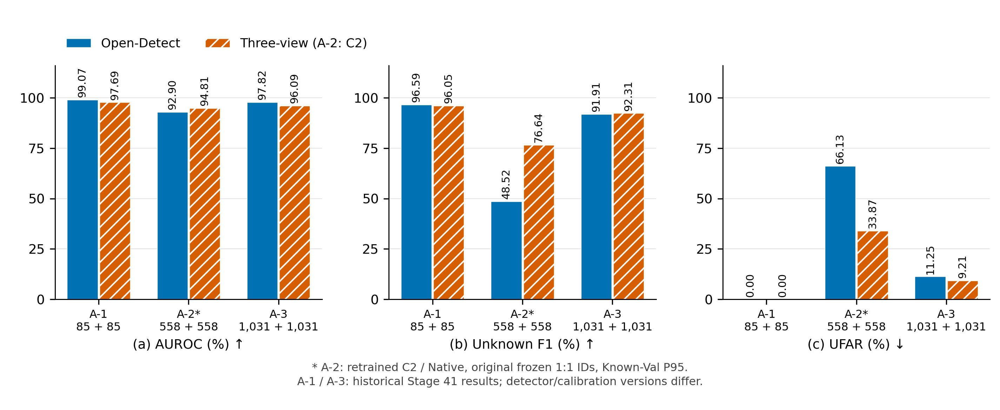

# 4 实验结果与分析

为系统评估所提出方法的有效性，本文围绕已知类别识别、未知类别拒识及模块贡献三个方面，提出以下问题（RQs）：

- **RQ1：本文方法在已知类别识别任务中是否具有优势？**
- **RQ2：本文方法能否有效识别并拒绝未知服务和攻击？**
- **RQ3：各视图与经验支撑机制是否对拒识性能具有贡献？**

针对上述研究问题，本文设计相应实验进行验证。对于 **RQ1**，在第4.2节中，通过ISCX-VPN、ISCX-Tor等数据集上的相关任务，与现有方法进行对比，评估其在不同类别粒度下的已知类别识别性能。对于 **RQ2**，在第4.3节中，利用VNAT完整服务留出、USTC-TFC2016类别留出及CIC-IDS2017未知攻击检测任务，评估本文方法对不同未知服务和未知攻击的拒识能力；同时，在第4.5节中进一步考察拒识阈值、未知类别比例及组成变化对检测性能的影响。对于 **RQ3**，在第4.4节中，通过相同冻结表示下的拒识分数对照和视图消融实验，分析局部经验支撑信息及不同视图分支对检测性能的贡献。

## 4.1 实验设置

### 4.1.1 数据集与任务划分

实验以双向流为样本单位，使用ISCX-VPN [36]、ISCX-Tor [37]、USTC-TFC2016 [38]、CIC-IDS2017 [39] 和VNAT [40]。

ISCX-VPN与ISCX-Tor分别保留六类、七类原服务标签，用于当前方法与已有方法的闭集对照；另将Chat、Email和VoIP映射为Communication，形成四类、五类粗服务任务。两组任务使用相同的流及角色划分，但适配器和分类头依据对应标签训练。USTC-TFC2016采用A-1、A-2和A-3三种类别留出配置，已知／未知类别数分别为19／1、17／3和15／5，并在原来源划分内按类别确定性抽取10%的流。A-1留出Tinba，A-2留出Geodo、Htbot和Tinba，A-3在A-2基础上增加Miuref和Neris。

**表4-1 USTC-TFC2016、ISCX-VPN和ISCX-Tor类别及ID映射**

| ID | Class | ID | Class | ID | Class | ID | Class | ID | Class |
|:---:|:---:|:---:|:---:|:---:|:---:|:---:|:---:|:---:|:---:|
| U0 | Gmail | U7 | SMB | U14 | MySQL | V0 | Chat | T0 | Chat |
| U1 | FTP | U8 | BitTorrent | U15 | Htbot | V1 | Email | T1 | Email |
| U2 | Nsis-ay | U9 | WorldOfWarcraft | U16 | Tinba | V2 | File Transfer | T2 | File Transfer |
| U3 | Facetime | U10 | Shifu | U17 | Skype | V3 | P2P | T3 | P2P |
| U4 | Weibo | U11 | Outlook | U18 | Miuref | V4 | Streaming | T4 | Audio-streaming |
| U5 | Cridex | U12 | Virut | U19 | Neris | V5 | VoIP | T5 | Video-streaming |
| U6 | Zeus | U13 | Geodo | — | — | — | — | T6 | VoIP |

**注：** U 表示 USTC-TFC2016，V 表示 ISCX-VPN，T 表示 ISCX-Tor。

**表4-2 实验场景与已知／未知类别划分**

| Scenario | Known Classes (KC) | Unknown Classes (UC) |
|---|---|---|
| A-1 | USTC-TFC2016 \ {U16} | U16 (Tinba) |
| A-2 | USTC-TFC2016 \ {U13, U15, U16} | U13 (Geodo), U15 (Htbot), U16 (Tinba) |
| A-3 | USTC-TFC2016 \ {U13, U15, U16, U18, U19} | U13 (Geodo), U15 (Htbot), U16 (Tinba), U18 (Miuref), U19 (Neris) |
| VPN-4C | {V0+V1+V5, V2, V3, V4} | None (closed-set) |
| Tor-5C | {T0+T1+T6, T2, T3, T4, T5} | None (closed-set) |

CIC-IDS2017设置两类独立实验。已知分类任务包含BENIGN、DoS Slowhttptest和PortScan，未知攻击诊断仅以BENIGN和PortScan为已知类别，使用对应模型评估十类未知攻击。

VNAT将十种应用映射为通信、文件传输、远程访问和流媒体四类服务。通信包括Skype与Zoiper，文件传输包括rsync、scp与sftp，远程访问包括SSH与RDP，流媒体包括Netflix、Vimeo与YouTube。

**表4-3 VNAT完整服务留出实验的样本组成**

| 留出的未知服务 | Known Train | Known Validation | Known Test | Unknown Test |
|:---|---:|---:|---:|---:|
| Communication | 17,352 | 2,509 | 1,380 | 2,208 |
| File Transfer | 14,604 | 2,021 | 954 | 5,870 |
| Remote Access | 7,705 | 1,129 | 1,008 | 13,607 |
| Streaming | 17,693 | 2,531 | 1,461 | 1,764 |

VNAT任务以服务类别为评价单位，各折的应用组成和采集组覆盖沿用冻结划分。

### 4.1.2 实验配置

实验在配备8块 NVIDIA L20 GPU的服务器上开展。模型采用 Adam 优化器，学习率设为0.001，批量大小为256，各阶段平均训练100轮。

### 4.1.3 对比方法

为验证所提出方法的有效性，本文选取多种具有代表性的加密流量识别方法进行对比，涵盖闭集分类与未知类别检测两类任务。各对比方法介绍如下：

**（1）用于已知类别分类性能对比的方法：**

- **TrafficFormer：** [2] 基于Transformer架构，通过注意力机制学习网络流量的上下文特征，实现加密流量分类。
- **YaTC：** [6] 利用自监督预训练学习网络流量的通用特征表示，并通过下游任务微调实现流量类别识别。
- **Open-Detect：** [11] 基于变分自编码器与高斯类别原型，通过生成约束和判别约束增强类内紧凑性与类间可分性。
- **RoNeTC：** [30] 面向加密流量分类的深度学习方法，通过学习流量特征实现类别判别。
- **TFE-GNN：** [7] 将网络流量构建为图结构，利用图神经网络提取流量交互特征并完成分类。
- **Trident：** [14] 基于流量统计特征构建分类模型，利用流量行为信息进行细粒度类别识别。

**（2）用于未知类别检测的方法：**

- **Open-Detect Native：** [11] 采用变分编码器学习流量的潜在概率分布，并通过样本后验分布与类别高斯原型之间的最小KL散度识别未知类别。
- **MSP：** [25] 基于分类器输出的最大Softmax概率衡量预测置信度，将低置信度样本判定为未知类别。
- **Energy：** [26] 根据分类器输出的Logits计算能量分数，利用已知与未知样本的分数差异实现拒识。
- **DES-v0：** 基于已知类别的经验质心构建距离分数，衡量待测样本与已知类别特征分布的偏离程度。
- **DES-v1：** 在经验质心的基础上进一步引入类内近邻支撑信息，综合评估样本与已知类别的局部特征一致性。

其中，MSP、Energy、DES-v0和DES-v1均基于相同的冻结融合特征与分类输出进行评估，并使用已知验证集独立校准拒识阈值，以保证不同拒识策略之间的比较公平性。

### 4.1.4 评价指标与统计口径

已知类别分类采用Accuracy、Macro-Precision、Macro-Recall、Macro-F1和Weighted-F1评价模型的分类性能。Macro-Precision、Macro-Recall和Macro-F1分别对各类别的精确率、召回率和F1等权平均；Weighted-F1按照真实类别样本数加权平均。Macro-F1并非Macro-Precision与Macro-Recall的调和平均值。Weighted-Precision与Weighted-Recall作为补充指标保存在结果表中；单标签多分类下，Weighted-Recall等于Accuracy。未知类别检测采用AUROC、AUPRC、未知类F1、未知误接收率（UFAR）和已知误拒率（Known FRR）进行评价。其中，将未知类别视为正类，AUROC和AUPRC分别衡量模型对未知类别的整体排序能力和精确率-召回率表现，未知类F1反映固定阈值下未知类别的综合识别性能。ROC与精确率-召回率曲线能够从不同角度反映类别不平衡下的检测表现 [41]。

设未知测试集为$D_U$，已知测试集为$D_K^{test}$，未知检测分数为$s(x)$，拒识阈值为$\tau$，则：

$$
\mathrm{UFAR}=
\frac{|\{x\in D_U:s(x)\leq\tau\}|}{|D_U|},
$$

$$
\mathrm{Known\ FRR}=
\frac{|\{x\in D_K^{test}:s(x)>\tau\}|}{|D_K^{test}|}.
$$

其中，UFAR表示未知流量被错误接受为已知类别的比例，Known FRR表示已知流量被错误拒识的比例。本文采用已知验证集检测分数的第95百分位数（P95）作为主拒识阈值，使用higher分位数规则确定阈值，并统一规定当$s(x)>\tau$时判定为未知类别。阈值敏感性实验进一步采用P90和P99作为补充工作点。

此外，部分配对实验按照预先固定的流标识构建已知／未知1∶1测试子集，以考察测试样本比例对检测结果的影响。AUPRC采用平均精确率计算。

## 4.2 已知类别识别性能

已知类别分类与未知类别拒识分别对应开集识别中的类别判别与未知检测任务，具有不同的评价目标。为评估本方法对不同类型加密流量的分类能力，首先在ISCX-VPN六类、ISCX-Tor七类原服务任务上，使用相同的冻结流样本和标签，与六种代表性方法及本文早期E3双视图版本进行闭集对照。各配置均保留种子2022和2023的结果，并报告两次运行的均值与总体标准差。

**表4-5 原服务标签下的八配置闭集分类性能对比（%，两个种子的均值 ± 总体标准差）**

<table>
  <thead>
    <tr>
      <th rowspan="2">方法</th>
      <th colspan="5">ISCX-VPN（六类）</th>
      <th colspan="5">ISCX-Tor（七类）</th>
    </tr>
    <tr>
      <th>Accuracy ↑</th>
      <th>Macro-Precision ↑</th>
      <th>Macro-Recall ↑</th>
      <th>Macro-F1 ↑</th>
      <th>Weighted-F1 ↑</th>
      <th>Accuracy ↑</th>
      <th>Macro-Precision ↑</th>
      <th>Macro-Recall ↑</th>
      <th>Macro-F1 ↑</th>
      <th>Weighted-F1 ↑</th>
    </tr>
  </thead>
  <tbody>
    <tr>
      <td>TrafficFormer（预训练）</td>
      <td>85.32 ± 0.41</td>
      <td>86.12 ± 0.32</td>
      <td>86.60 ± 0.38</td>
      <td>86.06 ± 0.40</td>
      <td>84.74 ± 0.43</td>
      <td>83.12 ± 0.58</td>
      <td>82.37 ± 0.81</td>
      <td>82.09 ± 0.41</td>
      <td>82.13 ± 0.64</td>
      <td>83.24 ± 0.51</td>
    </tr>
    <tr>
      <td>YaTC（预训练）</td>
      <td>87.83 ± 1.19</td>
      <td>88.64 ± 1.18</td>
      <td>88.88 ± 1.08</td>
      <td>88.71 ± 1.16</td>
      <td>87.65 ± 1.26</td>
      <td>84.38 ± 0.13</td>
      <td>82.78 ± 0.25</td>
      <td>82.79 ± 0.05</td>
      <td>82.74 ± 0.08</td>
      <td>84.36 ± 0.15</td>
    </tr>
    <tr>
      <td>Open-Detect（corrected-paper）</td>
      <td>72.87 ± 1.42</td>
      <td>74.57 ± 1.28</td>
      <td>74.63 ± 1.50</td>
      <td>74.43 ± 1.42</td>
      <td>72.54 ± 1.35</td>
      <td>62.85 ± 8.33</td>
      <td>61.06 ± 8.90</td>
      <td>58.12 ± 9.62</td>
      <td>57.66 ± 9.97</td>
      <td>61.48 ± 9.13</td>
    </tr>
    <tr>
      <td>RoNeTC（重建版）</td>
      <td>70.68 ± 0.69</td>
      <td>71.72 ± 0.41</td>
      <td>72.17 ± 1.31</td>
      <td>71.57 ± 0.81</td>
      <td>70.13 ± 0.51</td>
      <td>60.43 ± 1.07</td>
      <td>56.53 ± 1.79</td>
      <td>52.78 ± 1.52</td>
      <td>53.40 ± 1.98</td>
      <td>59.34 ± 1.74</td>
    </tr>
    <tr>
      <td>TFE-GNN-8-UDP-short（适配版）</td>
      <td>64.87 ± 1.92</td>
      <td>66.00 ± 1.49</td>
      <td>66.72 ± 1.96</td>
      <td>65.85 ± 1.46</td>
      <td>64.45 ± 1.63</td>
      <td>60.07 ± 0.09</td>
      <td>61.68 ± 3.58</td>
      <td>56.08 ± 0.99</td>
      <td>55.36 ± 1.38</td>
      <td>58.81 ± 0.87</td>
    </tr>
    <tr>
      <td>Trident-early8-86D（适配版）</td>
      <td>61.34 ± 0.23</td>
      <td>62.97 ± 0.30</td>
      <td>63.91 ± 0.26</td>
      <td>63.22 ± 0.06</td>
      <td>60.65 ± 0.05</td>
      <td>63.29 ± 0.27</td>
      <td>59.68 ± 0.16</td>
      <td>62.54 ± 0.18</td>
      <td>60.53 ± 0.19</td>
      <td>63.24 ± 0.33</td>
    </tr>
    <tr>
      <td>E3（早期双视图）</td>
      <td>85.00 ± 0.82</td>
      <td>85.76 ± 0.73</td>
      <td>86.30 ± 0.75</td>
      <td>85.95 ± 0.70</td>
      <td>84.64 ± 0.74</td>
      <td>83.21 ± 0.67</td>
      <td>82.23 ± 0.92</td>
      <td>82.46 ± 0.48</td>
      <td>82.22 ± 0.76</td>
      <td>83.39 ± 0.60</td>
    </tr>
    <tr>
      <td><strong>本方法（三视图）</strong></td>
      <td><strong>88.47 ± 0.64</strong></td>
      <td><strong>89.31 ± 0.53</strong></td>
      <td><strong>89.47 ± 0.58</strong></td>
      <td><strong>89.37 ± 0.55</strong></td>
      <td><strong>88.36 ± 0.60</strong></td>
      <td><strong>87.82 ± 0.36</strong></td>
      <td><strong>86.58 ± 0.07</strong></td>
      <td><strong>86.77 ± 0.36</strong></td>
      <td><strong>86.63 ± 0.15</strong></td>
      <td><strong>87.88 ± 0.34</strong></td>
    </tr>
  </tbody>
</table>

注：VPN的训练／验证／测试流数为8,764／1,098／1,093，Tor为8,946／1,118／1,117；同一数据集内各配置使用相同的冻结流标识和标签。标准差采用总体标准差（ddof=0）。Open-Detect采用corrected-paper实现，RoNeTC为重建版，TFE-GNN和Trident为表中注明的适配版。完整Weighted-Precision、Weighted-Recall、逐种子和逐类别数据见[Precision／Recall补充结果](../../../stage47_precision_recall_supplement_20261103/table_precision_recall.md)。

本方法在VPN和Tor上的Macro-F1分别为89.37%和86.63%，相较于YaTC分别提高0.66和3.89个百分点；相较于早期E3双视图，分别提高3.42和4.41个百分点。新增Macro-Precision与Macro-Recall在两个数据集上也取得本表最高均值，说明增益同时体现在精确率和召回率上。这些结果支持三视图方法在当前冻结流协议下的闭集分类优势，但两个种子不足以判定普遍统计显著性，且本表不能单独归因于某个分支或证明未知拒识改善。各分支对未知拒识的具体作用将在第4.4.2节通过受控消融检验。

为进一步考察本方法在不同标签粒度和任务类型下的适用性，本文在 VPN 四类粗服务任务、Tor 五类粗服务任务、USTC-TFC2016 十七类已知分类任务以及 CIC-IDS2017 三类平衡分类任务上开展补充实验。表4-6汇总了本方法在上述任务中的分类结果。

**表4-6 当前三视图方法的已知分类结果（%）**

| 数据集与任务 | 类别数 | 训练／验证／测试流数 | Accuracy ↑ | Macro-F1 ↑ | Weighted-F1 ↑ |
| --- | ---: | ---: | ---: | ---: | ---: |
| ISCX-VPN，服务分类 | 4 | 8,764／1,098／1,093 | 91.58 | 91.94 | 91.45 |
| ISCX-Tor，服务分类 | 5 | 8,946／1,118／1,117 | 89.62 | 89.94 | 89.67 |
| USTC-TFC2016，A-2已知分类 | 17 | 34,665／4,333／4,333 | 98.43 | 98.76 | 98.43 |
| CIC-IDS2017，三类平衡任务 | 3 | 35,516／3,912／2,536 | 99.80 | 99.75 | 99.80 |

本方法在USTC和CIC上的Macro-F1分别达到98.76%和99.75%，在VPN和Tor粗服务任务上分别达到91.94%和89.94%。其中，CIC中BENIGN、Slowhttptest和PortScan的类别F1分别达到99.84%、99.62%和99.78%，表明模型对各类别均具有较为稳定的识别能力。USTC涉及17个已知类别，仍取得98.76%的Macro-F1，说明三视图表示能够有效区分较多类别之间的特征差异。

## 4.3 未知类别拒识性能

闭集分类性能无法充分反映模型对未知流量的拒识能力。因此，本文在VNAT、USTC-TFC2016和CIC-IDS2017上开展开集检测实验，评估模型的未知类别识别能力及其在不同类别留出场景下的表现。

**整体拒识性能对比。** 为评估模型在完整服务留出条件下的未知类别检测能力，本文在VNAT数据集上将本方法与Open-Detect进行比较。表4-7展示了两种方法在四种未知服务场景下的AUROC、未知类F1、UFAR和Known FRR。

<table>
<thead>
<tr>
<th rowspan="2" style="text-align:center">服务场景</th>
<th colspan="2" style="text-align:center">AUROC ↑</th>
<th colspan="2" style="text-align:center">Unknown F1 ↑</th>
<th colspan="2" style="text-align:center">UFAR ↓</th>
<th colspan="2" style="text-align:center">Known FRR ↓</th>
</tr>
<tr>
<th style="text-align:center">Open-Detect</th>
<th style="text-align:center">DES-v1</th>
<th style="text-align:center">Open-Detect</th>
<th style="text-align:center">DES-v1</th>
<th style="text-align:center">Open-Detect</th>
<th style="text-align:center">DES-v1</th>
<th style="text-align:center">Open-Detect</th>
<th style="text-align:center">DES-v1</th>
</tr>
</thead>
<tbody>
<tr>
<td style="text-align:center">Communication</td>
<td style="text-align:center">81.8</td>
<td style="text-align:center"><b>99.5</b></td>
<td style="text-align:center">34.2</td>
<td style="text-align:center"><b>98.5</b></td>
<td style="text-align:center">78.9</td>
<td style="text-align:center"><b>0.1</b></td>
<td style="text-align:center"><b>3.5</b></td>
<td style="text-align:center">4.9</td>
</tr>
<tr>
<td style="text-align:center">File Transfer</td>
<td style="text-align:center">60.0</td>
<td style="text-align:center"><b>99.5</b></td>
<td style="text-align:center">0.3</td>
<td style="text-align:center"><b>99.3</b></td>
<td style="text-align:center">99.9</td>
<td style="text-align:center"><b>0.6</b></td>
<td style="text-align:center">10.0</td>
<td style="text-align:center"><b>4.6</b></td>
</tr>
<tr>
<td style="text-align:center">Remote Access</td>
<td style="text-align:center">58.9</td>
<td style="text-align:center"><b>98.8</b></td>
<td style="text-align:center">5.7</td>
<td style="text-align:center"><b>98.0</b></td>
<td style="text-align:center">97.0</td>
<td style="text-align:center"><b>3.8</b></td>
<td style="text-align:center"><b>2.4</b></td>
<td style="text-align:center">2.9</td>
</tr>
<tr>
<td style="text-align:center">Streaming</td>
<td style="text-align:center">96.1</td>
<td style="text-align:center"><b>99.1</b></td>
<td style="text-align:center">90.6</td>
<td style="text-align:center"><b>97.8</b></td>
<td style="text-align:center">13.0</td>
<td style="text-align:center"><b>0.0</b></td>
<td style="text-align:center">6.0</td>
<td style="text-align:center"><b>5.5</b></td>
</tr>
</tbody>
</table>

**表4-7 VNAT完整服务留出实验中两种方法的未知类别检测性能对比。**

表4-7显示，本方法在四种服务留出场景下的AUROC和未知类F1均高于Open-Detect。其中文件传输场景的AUROC和未知类F1分别由59.97%和0.30%提升至99.48%和99.34%，远程访问场景分别由58.88%和5.74%提升至98.76%和97.98%。四折平均UFAR由72.19%降至1.09%，Known FRR由5.46%降至4.45%。尽管通信和远程访问场景的Known FRR略有上升，但整体误拒率有所降低，表明本方法能够有效改善未知服务拒识性能。

为排除测试集中已知／未知样本比例的影响，本文进一步在预先固定的1∶1配对子集上进行评估。本方法的平均AUROC、AUPRC和未知类F1分别达到99.25%、98.93%和97.32%，均高于Open-Detect的74.17%、68.24%和32.02%，表明本方法的检测优势并非仅由测试集类别比例差异造成。

**不同未知类别配置下的拒识表现。** 为考察未知类别数量及组成变化对模型拒识性能的影响，本文在USTC-TFC2016上设置A-1、A-2和A-3三种类别留出场景，实验结果如图4-1所示。

在图4-1保留的A-2原冻结平衡测试集（558条已知流与558条未知流）上，重新训练后的三视图+C2配置取得94.81%的AUROC和76.64%的未知类F1，Open-Detect对应为92.90%和48.52%；UFAR由66.13%降至33.87%。该评估保留全部558条原未知流，包括410条Geodo，未采用此前按检测错误筛选的测试成员。两种方法均沿用新实验冻结的Known Validation P95阈值，其中相同2,171条验证流用于阈值校准，另2,162条验证流用于本方法的稳健缩放。A-3保留原Stage 41结果，未知类F1由91.91%提高至92.31%，UFAR由11.25%降至9.21%；A-1两种方法的UFAR均为0。A-2使用新C2单位L2支撑表示及配对校准，A-1、A-3使用原DES-v1配置，因此本图记录各配置的实测比较，不能视为同一检测配置在三个场景下的统一验证。

**图4-1 USTC三种类别留出配置下的未知类别检测性能对比。（a）AUROC；（b）未知类F1；（c）UFAR。各场景采用原冻结1∶1测试成员，阈值均由Known Validation P95确定。A-2*为新训练的C2／Open-Detect配对结果；A-1和A-3保留Stage 41结果，检测表示与校准版本存在差异。**

**不同未知攻击的类别级响应。** 为进一步分析拒识性能在攻击类别之间的差异，CIC-IDS2017实验固定以BENIGN和PortScan训练的模型、训练支撑库、P95阈值及2,272条已知测试流，逐类加入十种未知攻击。表4-7同时报告MSP和DES-v1的AUROC，以及DES-v1的AUPRC和UFAR，以对比传统分类置信度与经验支撑分数在不同未知攻击上的表现。

**图4-2 CIC十类未知攻击的识别结果（%，原测试池比例，P95）**

| 未知攻击 | 未知流数 | MSP AUROC | DES-v1 AUROC | DES-v1 AUPRC | DES-v1 UFAR ↓ |
| --- | ---: | ---: | ---: | ---: | ---: |
| DoS slowloris | 5,709 | 81.47 | **99.31** | 99.67 | 0.04 |
| DoS GoldenEye | 7,441 | 33.17 | **97.00** | 97.72 | 0.24 |
| DoS Hulk | 155,168 | 9.38 | **97.38** | 99.88 | 0.11 |
| FTP-Patator | 3,985 | 98.75 | **99.83** | 99.86 | 0.00 |
| SSH-Patator | 2,987 | 86.97 | **99.13** | 98.93 | 0.00 |
| Web Attack – Brute Force | 1,364 | 91.61 | **99.57** | 99.14 | 0.00 |
| Web Attack – XSS | 629 | 97.80 | **99.75** | 98.84 | 0.00 |
| DoS Slowhttptest | 5,096 | 85.97 | **99.34** | 99.63 | 0.14 |
| DDoS | 76,613 | 5.82 | **94.90** | 99.45 | 16.61 |
| Bot | 1,228 | 62.91 | **94.64** | 87.58 | 50.90 |

DES-v1在十类未知攻击中的八类上取得了不超过0.24%的UFAR，整体拒识效果较好，所有攻击类别对应的Known FRR为7.13%。其中，在Hulk攻击检测中，MSP的AUROC仅为9.38%，而DES-v1达到97.38%，表明经验支撑距离能够有效弥补分类置信度在部分未知攻击识别中的不足。相比之下，Bot和DDoS仍是较难识别的类别，其UFAR分别达到50.90%和16.61%，说明不同攻击类型与已知类别之间的特征重叠程度会影响拒识效果。

值得注意的是，DDoS的AUPRC达到99.45%，但其在原测试池中的未知样本占比高达97.12%，同时UFAR仍为16.61%。这表明在类别分布不均衡的情况下，较高的AUPRC并不意味着固定阈值下具有较低的误接收率，精确率-召回率表现还受到类别占比的影响 [41]。因此，需要结合排序指标与阈值相关指标综合评价模型的拒识性能。结合VNAT和USTC的实验结果可以看出，本方法在整体未知检测和多数类别识别中均表现出较好的性能，但对部分特征分布与已知类别存在重叠的未知攻击仍有进一步改进空间。

## 4.4 拒识机制与多模块消融

### 4.4.1 全局与局部经验支撑的作用

为区分完整系统收益与拒识规则的贡献，固定VNAT四折的编码器、融合特征$h(x)$及分类输出$\ell(x)$，仅更换未知分数。MSP和Energy使用分类输出，DES-v0使用最近经验质心平方距离，DES-v1进一步结合最近质心类别内的10近邻欧氏距离均值。各分数独立使用已知验证集校准阈值，表4-8给出结果。

**表4-8 相同冻结表示上的拒识分数对比（%，四折等权平均，原测试池比例，P95）**

| 拒识分数 | AUROC ↑ | AUPRC ↑ | 未知类F1 ↑ | UFAR ↓ | Known FRR ↓ |
| --- | ---: | ---: | ---: | ---: | ---: |
| MSP | 91.83 | 96.66 | 90.55 | 14.63 | 4.93 |
| Energy | 91.73 | 96.58 | 89.96 | 15.40 | 4.87 |
| DES-v0（仅经验质心） | 97.43 | 98.79 | 96.10 | 5.59 | 4.87 |
| **DES-v1（全局＋局部）** | **99.22** | **99.50** | **98.40** | **1.09** | **4.45** |

局部近邻信息在固定表示上进一步改善了未知检测。相较DES-v0，DES-v1将平均AUROC从97.43%提高至99.22%，UFAR从5.59%降至1.09%，Known FRR从4.87%降至4.45%。四折AUROC均提高，其中远程访问由94.47%提高至98.76%，通信由98.24%提高至99.54%。该对照为第3章全局与局部经验支撑的组合设计提供了直接实验依据：局部真实样本邻域补充了类别均值之外的拒识信息。

文件传输一折进一步展示了两种错误率的取舍：DES-v1将Known FRR从5.03%降至4.61%，同时UFAR由0.36%升至0.56%。因此，局部支撑的收益主要表现为四折排序及平均接收行为的改善，具体工作点仍需结合已知业务误拒和未知误接收共同评价。

**图4-3 相同三视图表示上的拒识分数消融。列为四种未知服务，行对应四种分数；依次报告AUROC、UFAR和Known FRR，单元格均为百分比。**

### 4.4.2 视图贡献

为检验各分支对最终表示的贡献，本文在相同VNAT四折设置下开展视图消融实验，分别移除FIG、YaTC和TrafficFormer分支。实验过程中，编码器、高斯适配器及标准化参数保持冻结，融合头结构与训练配置保持一致，以保证不同配置之间的可比性。表4-9给出了各配置下的闭集分类与未知检测结果。

**表4-9 VNAT同配置视图消融（%，四折等权平均，DES-v1，原测试池比例，P95）**

| 配置 | 已知Macro-F1 ↑ | AUROC ↑ | AUPRC ↑ | 未知类F1 ↑ | UFAR ↓ | Known FRR ↓ |
| --- | ---: | ---: | ---: | ---: | ---: | ---: |
| 完整三视图 | 99.87 | 99.22 | 99.50 | 98.40 | 1.09 | 4.45 |
| 去FIG | 97.08 | 97.45 | 97.37 | 97.24 | 1.41 | 3.49 |
| 去YaTC | 96.56 | 95.92 | 96.75 | 89.83 | 14.80 | 4.91 |
| 去TrafficFormer | 95.21 | 96.35 | 94.81 | 94.14 | 8.53 | 4.81 |

从表4-9可以看出，移除任一分支均会导致部分关键检测指标下降。其中，移除YaTC后，未知类F1由98.40%降至89.83%，UFAR由1.09%升至14.80%，表明多层级字节表示对于区分未知流量与已知类别具有重要作用。移除TrafficFormer后，AUPRC由99.50%降至94.81%，未知类F1降至94.14%，说明字节序列中的上下文信息能够为已知类别判别和未知检测提供有效补充。移除FIG后，AUROC和AUPRC分别降至97.45%和97.37%，未知类F1降至97.24%，UFAR升至1.41%，表明流交互图能通过刻画报文间的关系，为流量判别和未知检测提供结构信息。总体而言，三种视图从不同角度提供互补信息，共同提升了模型的已知类别识别与未知类别拒识能力。

## 4.5 拒识阈值与测试分布敏感性

### 4.5.1 拒识阈值的影响

前述结果采用固定P95工作点。本节保持VNAT网络、训练支撑库及分数不变，以已知验证分数的P90和P99作为补充工作点，观察误接收与误拒的变化。表4-10使用已有四折结果，P95保持为主工作点。

**表4-10 VNAT的验证分位数阈值敏感性（%，DES-v1，四折等权平均，原测试池比例）**

| 验证分位数 | 未知类F1 ↑ | UFAR ↓ | Known FRR ↓ |
| --- | ---: | ---: | ---: |
| P90 | 97.26 | 0.91 | 10.02 |
| P95 | 98.40 | 1.09 | 4.45 |
| P99 | 85.94 | 20.98 | 1.23 |

验证分位数直接控制了已知接受与未知漏识之间的取舍。P90将平均UFAR降至0.91%，Known FRR升至10.02%；P99将Known FRR降至1.23%，UFAR升至20.98%。阈值越宽松，已知接受率越高，未知漏识也可能增多。三个工作点共享同一分数，AUROC与AUPRC保持不变，说明固定阈值错误率能够补充排序指标对接收行为的描述。

### 4.5.2 未知比例与类别组成

阈值敏感性考察同一分布下的接受标准，混合测试进一步考察测试样本组成的影响。在CIC十类攻击的冻结分数池上，每次抽取2,000条流，并采用20个确定性种子重复。已知／未知各半、十类未知均衡时，DES-v1平均AUROC为98.10%，未知类F1为93.12%，UFAR为6.71%，Known FRR为7.07%。模型与P95阈值全程保持冻结。

未知数量比例变化下，当前分数仍保持较稳定的排序和条件错误率。保持十类未知内部均衡，已知∶未知由9∶1变为1∶9时，AUROC为98.04%至98.13%，UFAR为6.73%至6.95%；AUPRC则随未知占比增加由85.26%升至99.73%。相比之下，固定1∶1比例但仅混合Bot与DDoS时，UFAR升至33.84%。正常与PortScan的组成变化也会影响Known FRR。结合逐攻击结果，相较于未知数量比例，当前检测器对未知类别组成的变化更敏感；混合平均值应与类别级错误率共同报告。

**图4-4 CIC冻结分数池的比例与组成敏感性。（a）不同未知占比的AUROC与AUPRC；（b）对应UFAR与Known FRR。**

### 参考文献

[2] G. Zhou et al., [TrafficFormer: An Efficient Pre-trained Model for Traffic Data](https://doi.org/10.1109/SP61157.2025.00102), IEEE S&P, 2025, doi: 10.1109/SP61157.2025.00102.

[6] R. Zhao et al., [Yet Another Traffic Classifier: A Masked Autoencoder Based Traffic Transformer with Multi-Level Flow Representation](https://doi.org/10.1609/aaai.v37i4.25674), AAAI, 2023, doi: 10.1609/aaai.v37i4.25674.

[7] H. Zhang et al., [TFE-GNN: A Temporal Fusion Encoder Using Graph Neural Networks for Fine-grained Encrypted Traffic Classification](https://doi.org/10.1145/3543507.3583227), WWW, 2023, doi: 10.1145/3543507.3583227.

[11] Q. Meng et al., [Detection of Unknown Attacks Through Encrypted Traffic: A Gaussian Prototype-Aided Variational Autoencoder Framework](https://doi.org/10.1109/TIFS.2025.3612141), IEEE TIFS, 2025, doi: 10.1109/TIFS.2025.3612141.

[14] Z. Zhao et al., [Trident: A Universal Framework for Fine-Grained and Class-Incremental Unknown Traffic Detection](https://doi.org/10.1145/3589334.3645407), WWW, 2024, doi: 10.1145/3589334.3645407.

[25] D. Hendrycks and K. Gimpel, “A Baseline for Detecting Misclassified and Out-of-Distribution Examples in Neural Networks,” ICLR, 2017.

[26] W. Liu, X. Wang, J. Owens, and Y. Li, “Energy-based Out-of-distribution Detection,” NeurIPS, vol. 33, 2020.

[30] X. Wang, Y. Wang, Y. Lai, Z. Hao, and A. X. Liu, [Reliable Open-Set Network Traffic Classification](https://doi.org/10.1109/TIFS.2025.3544067), IEEE Trans. Inf. Forensics Secur., vol. 20, pp. 2313–2328, 2025, doi: 10.1109/TIFS.2025.3544067.

[36] G. Draper-Gil, A. H. Lashkari, M. S. I. Mamun, and A. A. Ghorbani, [Characterization of Encrypted and VPN Traffic Using Time-Related Features](https://www.unb.ca/cic/datasets/vpn.html), ICISSP, pp. 407–414, 2016.

[37] A. H. Lashkari, G. Draper-Gil, M. S. I. Mamun, and A. A. Ghorbani, [Characterization of Tor Traffic Using Time Based Features](https://www.unb.ca/cic/datasets/tor.html), ICISSP, 2017.

[38] W. Wang et al., [Malware traffic classification using convolutional neural network for representation learning](https://doi.org/10.1109/ICOIN.2017.7899588), ICOIN, pp. 712–717, 2017, doi: 10.1109/ICOIN.2017.7899588.

[39] I. Sharafaldin, A. H. Lashkari, and A. A. Ghorbani, [Toward Generating a New Intrusion Detection Dataset and Intrusion Traffic Characterization](https://www.unb.ca/cic/datasets/ids-2017.html), ICISSP, 2018.

[40] MIT Lincoln Laboratory, [VPN/Non-VPN Network Application Traffic Dataset (VNAT)](https://www.ll.mit.edu/r-d/datasets/vpnnonvpn-network-application-traffic-dataset-vnat), [Online]. Available: https://www.ll.mit.edu/r-d/datasets/vpnnonvpn-network-application-traffic-dataset-vnat. Accessed: Nov. 11, 2026.

[41] J. Davis and M. Goadrich, [The Relationship Between Precision-Recall and ROC Curves](https://doi.org/10.1145/1143844.1143874), ICML, pp. 233–240, 2006, doi: 10.1145/1143844.1143874.
