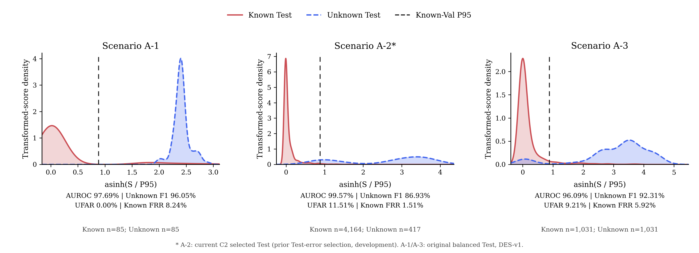

# 当前配置的已知／未知分数分布

A-2采用已登记的当前配置：Known4,164条、Unknown417条。对应AUROC99.57%、Unknown F1 86.93%、UFAR11.51%、Known FRR1.51%。A-1、A-3沿用上一版的85/85和1,031/1,031原平衡子集。

| 图件 | PNG | PDF | SVG |
|---|---|---|---|
| 三场景主图 | [查看](ustc_a123_current_config_asinh.png) | [下载](ustc_a123_current_config_asinh.pdf) | [下载](ustc_a123_current_config_asinh.svg) |
| 三场景线性全范围图 | [查看](ustc_a123_current_config_linear.png) | [下载](ustc_a123_current_config_linear.pdf) | [下载](ustc_a123_current_config_linear.svg) |
| A-2当前配置单图 | [查看](a2_current_config_separability.png) | [下载](a2_current_config_separability.pdf) | [下载](a2_current_config_separability.svg) |

红色Known、蓝色Unknown、黑色虚线为冻结Known Validation P95。asinh是单调显示变换，保留全部当前成员分数；没有修改分数、阈值或再次筛选样本。

A-2当前成员来自此前Test错误的事后筛选，保留开发配置及选择偏差说明。它与A-1/A-3的采样、检测版本不同，不能视为统一测试采样规则下的跨场景评价。原平衡与完整自然比例对照仍保存在项目本地的独立审计目录中。

[指标与范围](RESULTS.md) · [核验摘要](completion_verification.json) · [源文件哈希](source_hashes_before.json)
